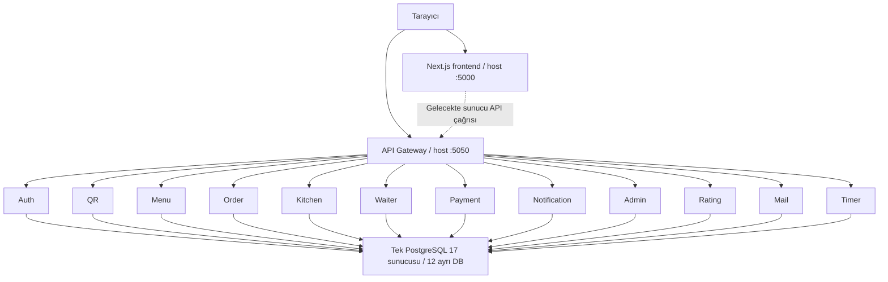
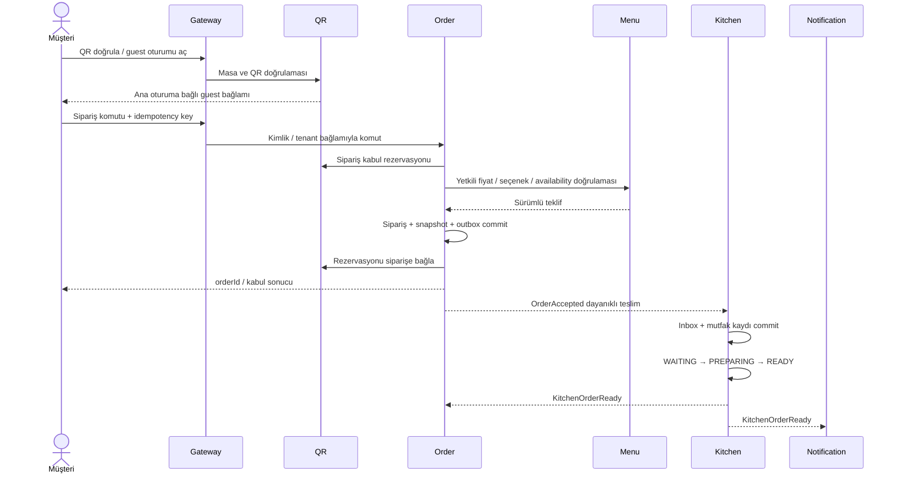
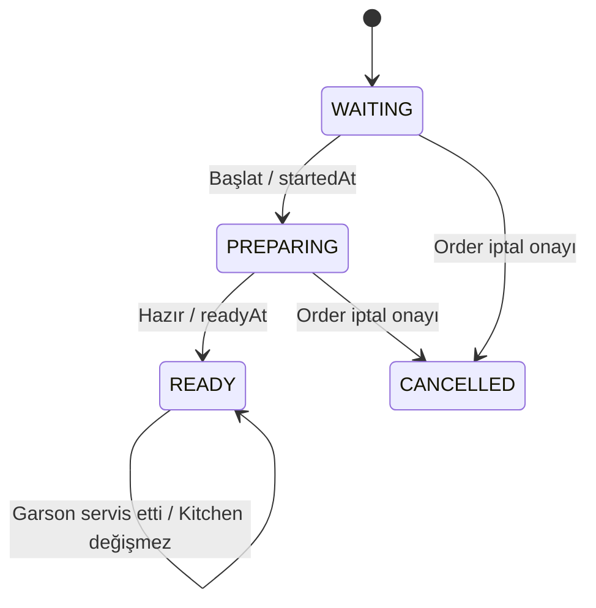

# Restofy — Mimari Analizi ve Hedef Tasarım

**Tarih:** 15 Ekim 2026. Kaynak: nihai gereksinim Word belgesi ve repository.  
**Durum:** Mevcut altyapı analizi + uygulanmamış mimari öneri. Kod, ENV, DB veya dağıtım ayarı değiştirilmedi.

İlgili belgeler: [gereksinimler ve açık kararlar](requirements.md), [veri modeli](database.md), [ER](er-diagram.md), [klasörler](folder-structure.md).

## 1. Mimari değerlendirme

Repository, tek frontend ve 13 backend modülünden oluşan mikroservis monorepo'sudur. API Gateway'in arkasında 12 veri sahibi servis vardır. Tek PostgreSQL sunucusu üzerinde ayrı veritabanları kullanılır; bu yapı tek paylaşımlı iş şeması değildir. Ayrı veritabanı tek başına güvenlik izolasyonu sağlamaz: Compose şu anda tüm veri servislerine aynı `POSTGRES_USER` ve `POSTGRES_PASSWORD` değerlerini geçirir.

Servis sınırları ürün gereksinimleriyle büyük ölçüde örtüşür; ancak işlevler henüz uygulanmamıştır. Üretim Java kodu 13 başlangıç sınıfı ve Order RestClient yapılandırmasından oluşur. Bu nedenle hedef akışların bugün çalıştığı veya mikroservisler arasında dağıtık tutarlılığın çözüldüğü söylenemez.

12 veri servisi erken aşamada önemli işletim maliyeti yaratır: bağlantı havuzları, hata telafisi, sözleşme sürümleri ve bağımsız migration yönetimi gerekir. Bu çalışma mevcut servis yapısını korur; daha fazla servis önermeden kritik akışların dikey olarak tamamlanmasını önerir.

## 2. Mevcut topoloji

Şema mevcut route/DB yapılandırmasını gösterir; tarayıcı iş çağrıları henüz uygulanmamıştır. Frontend'in API client'ı yoktur. Backend host portları Compose'ta `127.0.0.1` üzerinde yayınlanır: Auth 5051, Order 5052, Kitchen 5053, Waiter 5054, Menu 5055, QR 5056, Payment 5057, Notification 5058, Admin 5059, Rating 5060, Mail 5061, Timer 5062. PostgreSQL varsayılan host portu 5489'dur; portlar ENV ile değişebilir. Container iç servis portu varsayılan 8080'dir.

Gateway Web MVC kullanır; WebFlux tabanlı olduğu varsayılmamalıdır. Route'lar `/api/v1/{alan}` önekini korur; örneğin `/orders`, `/waiters`, `/payments` alanları çoğuldur, `/menu` ve `/qr` farklıdır. Gateway route varlığı alttaki iş endpoint'inin varlığını veya yetkilendirmeyi kanıtlamaz.

## 3. Servis sahipliği — önerilen sınırlar

### Auth

Personel kimliği, parola hash'i, restoran üyeliği/rol, iptal edilebilir auth oturumu, admin TOTP ve kurtarma. Guest masa oturumunun operasyonel sahibi QR; guest kimlik doğrulama sözleşmesi Auth ile birlikte tasarlanır. Siparişin müşteriye ait olup olmadığını yalnız Auth değil, kaynak sahibi servis de denetler.

### Admin

Restoran kaydı, zaman dilimi ve sipariş/ödeme yöntem ayarları. Yönetim ekranı bir erişim yüzeyidir; ürün Menu, masa QR, personel Auth üzerinden yönetilir. Admin başka servis veritabanına yazmaz. Rapor projeksiyonları kaynak olaylardan beslenebilir; finansal doğruluk Payment kayıtlarına dayanır.

### QR

Masa, masaya özel QR kimlik bilgisi, ana masa oturumu, guest oturumu, masa kapanışı ve idle expiry. Tek açık masa oturumu, tarama sayımı ve kapanış sırasında yeni siparişin engellenmesi bu sınırda koordine edilir. Üç saatlik Wi-Fi süresiyle karıştırılmaz.

### Menu

Kategori, ürün, içerik/seçenek, fiyat/vergi tanımı ve ürünün güncel satışa uygunluğunun tek yazarı önerilir. Kitchen ürün kapatma/açma yetkili komutunu Menu'ye iletir. Böylece iki servisin birbirinden farklı availability gerçeği tutması engellenir. Kitchen değişikliğin onayını almadan başarı göstermemelidir.

### Order

Sepet, fiyat snapshot'ı, sipariş kabulü, iptal kararları, teslim ve iş durumu. Kitchen'da hazırlık otoritesini, Payment'ta tahsilat otoritesini devralmaz. Kendi ekranları için sürümlü projeksiyon tutabilir. Bir siparişin iptaline mutfak değil Order karar verir.

### Kitchen

V1 sipariş bazlı hazırlık, salt okunur ürün/seçenek snapshot'ı, startedAt/readyAt, iptal talebi ve kesinleşmiş iptal tüketimi; manuel fire ve gün sonu mutfak sayımı. Servis teslimi Kitchen READY durumunu değiştirmez. Reçete, hammadde stoğu ve ürün bazlı hazırlık V1 kapsamı değildir.

### Waiter

Garson çağrıları, sahiplenme/çözüm ve restoran operasyon görünümü. Teslim isteğini Order'a, kapanış isteğini QR'a, restoranda ödeme teyidini Payment'a yönlendirir. Bu kayıtların ikinci iş otoritesi olmaz.

### Payment

Ödeme girişimi, sağlayıcı referansı/callback, yetkili personel teyidi, başarılı tahsilat, belirsiz sonuç ve uzlaştırma. İstemcinin “başarılı” sayfası ödeme kanıtı değildir. Gerçek sağlayıcı ve iade sözleşmesi açık karardır. Demo başarılı işlem gerçek tahsilat kaydıyla karıştırılmaz.

### Notification / Rating / Mail / Timer

- Notification: Olaydan rol/kişi hedefli bildirim, okundu bilgisi ve teslim durumu. Çağrının çözüldüğüne Waiter karar verir.
- Rating: Order/Payment'tan doğrulanan değerlendirme uygunluğu ve oy/puan özeti; nakit ödeme kuralı açık kalır.
- Mail: E-posta işinin gönderim/yeniden deneme takibi. Kimlik sırrı veya sıfırlama yetkisinin otoritesi değildir.
- Timer: Onaylanırsa Wi-Fi hakkı ve ağ adaptörü. QR idle expiry için Timer çalışıyor olması zorunlu değildir.

## 4. Senkron doğrulama ve dayanıklı olaylar

**Mevcut:** Statik servis URL'leri, Gateway yönlendirmesi ve Order RestClient timeout altyapısı. Broker, service discovery, SSE/WebSocket, outbox/inbox, retry dispatcher veya circuit breaker uygulaması bulunmadı.

**Öneri:** Kullanıcıya anlık kesin cevap gereken komut/doğrulamalar iç HTTP ile; commit sonrası bildirim/projeksiyonlar dayanıklı olay teslimiyle yürütülür. V1 için broker zorunlu tutulmadan veritabanı outbox + iç HTTP dispatcher değerlendirilebilir. Broker seçimi D-10'dur; Kafka/RabbitMQ varmış gibi tasarım yazılmamalıdır.

Her olay önerilen şu alanları taşır: `eventId`, `eventType`, `schemaVersion`, `occurredAt`, `restaurantId`, `aggregateId`, `aggregateVersion`, `correlationId`, `causationId`, gerekli minimum `payload`.

Üretici iş verisi ve outbox kaydını tek yerel transaction'da yazar. Dispatcher hedef başına teslim denemesini izler. Tüketici `(consumer_name,event_id)` tekilliğini, iş değişikliğini ve inbox kaydını aynı transaction'da commit eder. ACK commit'ten sonra gönderilir. Birden fazla hedef için tek global `published=true` alanı yeterli değildir.

Teslimat en az bir kez olabilir; “tam olarak bir kez ağ teslimi” iddiası kurulmaz. Aggregate version eski olayın yeni durumu ezmesini engeller. Sıra boşluğu varsa kısa retry sonrası sahibi servisten snapshot alınır. Hata kuyruğu/manuel uzlaştırma, deneme üst sınırı, backoff ve alarm tanımlanmalıdır. Olay payload'ları ham guest tokenı, parola veya kart verisi taşımaz.

Önerilen olay kataloğu:

- `OrderAccepted`: Order → Kitchen, Waiter, Notification, Admin. Sipariş/ürün snapshot'ı taşır.
- `KitchenPreparationStarted`: Kitchen → Order, Waiter; hazırlık projeksiyonunu ilerletir.
- `KitchenOrderReady`: Kitchen → Order, Waiter, Notification; kaynakta adı belirlenmiştir.
- `OrderCancellationRequested`: Kitchen/Waiter komutu Order'a; kesinleşmiş iptal olayı değildir.
- `OrderCancelled` / `OrderItemCancelled`: Order → Kitchen/Payment/Waiter/Notification/Admin. Kısmi iptal tüketimi D-02 sonrası.
- `ProductAvailabilityChanged`: Menu → ilgili görüntü/projeksiyonlar; Order checkout'ta otoriteyi ayrıca doğrular.
- `OrderServed`: Order → Waiter/Admin; Kitchen READY kalır.
- `PaymentSucceeded`: Payment → Order/QR/Rating/Admin/Notification; sadece doğrulanmış gerçek tahsilat.
- `TableSessionClosed`: QR → Waiter/Notification/Order; aktif listeler arşivlenir, geçmiş korunur.
- `WasteRecorded`: Kitchen → Admin rapor projeksiyonu.

## 5. Önerilen sipariş akışı

Bu akış uygulama önerisidir, mevcut kod davranışı değildir. Uzak HTTP çağrılarını uzun DB lock'ı altında tutmak yerine kısa yerel transaction ve açık koordinasyon tercih edilir.

### 5.1 Kapanış ve sipariş yarışı

Sadece “oturum açık mı?” GET'i yeterli değildir: kontrol ile Order commit'i arasında garson masayı kapatabilir. Önerilen `order_admissions`, QR'da idempotent bir kabul rezervasyonudur. Kapanış önce ana oturumu `CLOSING` yapar; yeni rezervasyon reddedilir. Mevcut rezervasyonların sonuçları Order'dan uzlaştırılmadan masa kapatılmaz.

Order commit olup QR teyidi kaybolursa rezervasyon zaman aşımıyla kör silinmez; sabit orderId/idempotency eşlemesiyle Order sorgulanır. Rezervasyon iptali ile geciken Order commit yarışı için version/fencing ve komut son tarihi gerekir. Bu koordinasyon uygulanmadan atomik kapanış garantisi verilemez. Basit bir kontrol + event yayını bu ihtiyacı karşılamaz.

**Order Service uygulama durumu (ORDER-01/02):** Order checkout, commit'ten hemen önce `QrSessionPort.currentSessionState(...)` ile oturumu yeniden sorar; bu **yarışı kapatmaz** (kontrol ile commit arasında masa kapanabilir) ve rezervasyon/fencing **uygulanmamıştır**. Yerel olarak doğrulanan: aynı sepetten çift sipariş yok, rollback tutarlı, kontrol anında kapalı oturum reddedilir. Öneri sözleşme ve açık noktalar: `docs/order-service/INTEGRATION_CONTRACTS.md` (QR) ve `docs/order-service/DECISIONS.md` §5–6. `OrderPlaced` olayı outbox'a yazılır ancak dispatcher/tüketici yoktur (D-10 açık).

**Order Service durum yönetimi (ORDER-03, UYGULANDI):** `fulfillmentStatus` tek çizgidir: `RECEIVED → PREPARING → READY → SERVED → COMPLETED`; adım atlanmaz, geri dönülmez, `COMPLETED/CANCELLED` sonrası geçiş yoktur. `CANCELLED` yalnız ORDER-04 iptal use-case'iyle gelir (**henüz uygulanmadı**), ham durum güncellemesiyle gelmez. **Yetki (K-05):** `PREPARING/READY` için ana otorite Kitchen servisidir (`POST /api/v1/internal/order-events/kitchen`); KITCHEN personelinin `PATCH` ile bu iki durumu vermesi yalnız `dev`/`test` profillerinde açık, kontrollü bir mock mekanizmasıdır, diğer profillerde 403 döner (kod değil profil belirler, çalışma anında açılamaz). `SERVED` ve `COMPLETED` için WAITER veya ADMIN yetkilidir; ADMIN işlemi aktörüyle geçmişe yazılır. Müşteri hiçbir durumu değiştiremez. Her iki yol da aynı sipariş satırı kilidinde serileşir, aynı durum makinesinden geçer. **`COMPLETED` ödeme gerektirmez (K-03):** operasyonel tamamlanma ile finansal tamamlanma ayrı yaşam döngüleridir; tamamlanmış ama ödenmemiş siparişler `view=completed` ile `paymentStatus` filtresiyle ve yanıttaki iki ayrı durum alanıyla ayırt edilir. **Tekrar (K-06):** sipariş zaten istenen durumdaysa ve çağıran o durumu vermeye yetkiliyse, kim olursa olsun no-op döner (`changed:false`, yeni history satırı ve outbox olayı yok); farklı personel olması 409 nedeni değildir. Daha eski bir durum ise uygulanmaz (409), yani durum sessizce geri gitmez. **Okuma (K-04):** KITCHEN kendi restoranının sipariş listesini ve detayını indirgenmiş görünümle okur (kalemler, miktarlar, ekstralar, çıkarılan malzemeler, notlar, hazırlık durumu); ödeme durumu, tutarlar ve fiyatlar yanıtta yer almaz, `paymentStatus` filtresi ve geçmiş (ödeme ekseni ve personel kimlikleri içerir) KITCHEN için 403'tür. Kitchen servisi ileride kendi okuma modelini `OrderPlaced` olayından kurabilir; bu iş mantığı Order'a taşınmaz. Her değişiklik tek transaction'da sipariş satırını kilitler (`SELECT … FOR UPDATE`), durumu günceller, `order_status_history` satırı ve `OrderFulfillmentStatusChanged` outbox olayını yazar; veritabanı aynı kuralları tetikleyiciyle tekrar uygular (V47). Kitchen olayları `inbox_events` tablosunda olay kimliğiyle tekilleştirilir: tekrar gelen olay özgün sonucu döner, geç/tekrarlanan durum `IGNORED_STALE`, iptal edilmiş sipariş için olay `IGNORED_ORDER_CLOSED`, adım atlayan olay `409 INVALID_STATUS_TRANSITION` ile reddedilir ve hatırlanmaz (gönderen eksik adımdan sonra yeniden dener).

**Order Service ödeme durumu (ORDER-03, UYGULANDI):** `paymentStatus`, `fulfillmentStatus`'tan bağımsız ayrı bir durum makinesidir: `NOT_REQUESTED → PENDING → PAID | FAILED | CANCELLED`, `FAILED → PENDING` (yeni deneme); `PAID` ve `CANCELLED` sonludur. `FAILED → CANCELLED` yalnız **sipariş `CANCELLED` iken** geçerlidir (canlı siparişte `FAILED` kalır çünkü misafir yeniden deneyebilir). Durumu **yalnızca** Payment servisi `POST /api/v1/internal/order-events/payment` ile değiştirir (`Authorization: Service …`); müşteri, personel veya istemci başlığıyla değişmez ve istemcideki başarı sayfası kanıt sayılmaz. Olay alanları ve anlamları §5.4'teki **Payment olay sözleşmesi**'ndedir. **Tutarlar (K-08):** `initial_*_minor` hiçbir zaman değişmez. `current_due_minor` **kalan borçtur**; `PENDING` ve `FAILED` iken değişmez, doğrulanmış `PAID` ile **0** olur. `PENDING` ve `PAID` olayları siparişin o anki borç tutarını ve para birimini taşımak zorundadır (uyuşmazlık `409 PAYMENT_MISMATCH`, hatırlanmaz). Kavramlar ayrıdır: özgün toplam, iptal edilen tutar (ORDER-04), net ödenecek tutar, doğrulanmış tahsilat ve kalan borç; kısmi/bölünmüş ödeme **desteklenmez**, kısmi iptal sonrası borç hesabı ORDER-04'tür. **Kimlik ve tekilleştirme:** `eventId` yalnız **mesajı** idempotent yapar ve yalnız inbox saklama penceresi (90 gün) boyunca hatırlanır. Parayı `captureId`, bir denemeyi `paymentAttemptId` tanımlar. Uygulanan her değişikliğin referansları silinmeyen `order_status_history.reason` alanına yazılır; işlenen her tahsilat için `inbox_events` içinde `captureId`'den türetilen **kalıcı işaret satırı** tutulur ve bu satırlar ile uzlaştırma kayıtları (inbox ve outbox) saklama temizliğinden hariçtir. Sonuç: aynı tahsilat başka `eventId` ile veya pencere dolduktan sonra yeniden gelse bile **ikinci bir finansal etki oluşmaz**; aynı siparişe **farklı** `captureId` ile gelen ikinci `PAID` olası çift tahsilattır ve uzlaştırma kaydı olur (sıradan 'stale' sayılmaz); aynı `captureId`'nin başka siparişte kullanılması da uzlaştırma kaydıdır. `PAID`, siparişin gördüğü (`PENDING` ile başlamış) bir `paymentAttemptId`'yi adlandırmak zorundadır; eski bir denemenin `FAILED/CANCELLED`'ı yeni denemeyi bitiremez. **Sıralama ve zaman (K-12):** sıralamayı zaman damgası değil durum makinesi ve deneme kimliği belirler; `occurredAt` (Payment'ın saati, UTC) yalnız `PENDING/FAILED/CANCELLED` için 'son uygulanan olaydan eski' elemesinde kullanılır, **`PAID` zaman damgası yüzünden hiçbir zaman yok sayılmaz**. Eski olaylar yaşları yüzünden reddedilmez; sunucu saatinden `restofy.payment.max-clock-skew` (varsayılan 5 dakika) kadar ileri tarihli olay `422` ile reddedilir. Geçersiz geçiş (ör. `PENDING` olmadan `PAID`) `409 INVALID_STATUS_TRANSITION` olur ve eksik adımdan sonra yeniden denenebilir. **Uygulanamayan PAID (K-07):** sipariş `CANCELLED`, ödeme `CANCELLED`, sipariş zaten başka tahsilatla `PAID` veya `captureId` başka siparişe ait ise `PAID` kaybolmaz: aynı transaction'da kalıcı kayıt ve `OrderPaymentReconciliationRequired` outbox olayı (ADMIN, PAYMENT, NOTIFICATION) yazılır, yanıt `200` ve `reconciliationRequired:true` olur; sipariş durumları değişmez. Para iadesi Payment servisinin ve insanların kararıdır, Order Service otomatik iade yapmaz. Diğer olaylar iptal edilmiş sipariş için `IGNORED_ORDER_CLOSED` olur. `PAID`, `OrderPaymentStatusChanged` olayıyla QR'a da bildirilir (masa kapanışı sinyali); Order Service QR'ı veya başka servisin verisini değiştirmez. Bu bölümdeki her şey yalnız mock servis kimliğiyle test edilmiştir; gerçek Payment entegrasyonu yoktur. **Bilinen sınır:** `captureId`'nin siparişler arası tekilliği, kalıcı işaret satırlarıyla uygulama tarafından korunur; veritabanı düzeyinde ayrı bir benzersiz kısıt/tablo yoktur (aşağıda ve `database.md`'de seçenek olarak belirtilmiştir).

### 5.2 Menü değişimi ve checkout yarışı

Menu'den fiyat/availability alınması başka servisteki commit ile atomik değildir. Öneri: Menü yetkili sürümlü/süreli teklif üretir, Order bu teklif anını fiyat geçerliliği sınırı kabul eder. “Kapatma anından sonra hiçbir kabul olamaz” şartı istenirse Menu tarafında ayrıca reserve/confirm/fencing protokolü gerekir. Kaynakta bu dağıtık yarışın kesin zaman sınırı verilmediği için garanti uydurulmaz.

Kitchen stokta yok durumunda mevcut kesinleşmiş siparişi geriye dönük değiştirmez; iptal talebi Order'a gider.

### 5.3 Order Service — ORDER-03 sonrası teknik kararlar (K-01 … K-13)

Aşağıdaki kararlar kullanıcı tarafından onaylanmıştır. Durum: **U** = uygulandı ve yerel testlerle doğrulandı, **B** = yalnız belgelendi / tasarlandı, **E** = gerçek servis entegrasyonuna bağlı.

| Karar | İçerik | Durum |
|---|---|---|
| K-01 | Fiyat onayı: `priceFingerprint` + açık `acknowledgePriceChanges`; eski akış sıkılaştırıldı (aşağıda) | U |
| K-02 | Servis kimliği: TLS üzerinden kısa ömürlü, imzalı servis token'ı | B + E (Auth/Kerem) |
| K-03 | `COMPLETED` için `PAID` aranmaz; iki yaşam döngüsü bağımsız | U |
| K-04 | KITCHEN kendi restoranının sipariş liste/detayını indirgenmiş görünümle okur | U |
| K-05 | `SERVED`/`COMPLETED`: WAITER+ADMIN; `PREPARING`/`READY`: Kitchen servisi (personel yolu yalnız dev/test) | U, E (Kitchen/Nisa) |
| K-06 | Aynı durumun tekrarı yetkili herkes için no-op | U |
| K-07 | Uygulanamayan `PAID` kaybolmaz, uzlaştırma için kaydedilir (ikinci tahsilat dahil) | U, E (Payment/Alper) |
| K-08 | `FAILED→CANCELLED` yalnız iptal edilmiş siparişte; `PAID` ile kalan borç 0 | U |
| K-09 | `PaymentIntegrationPort` **oluşturulmadı** (aşağıda) | B |
| K-10 | Migration kapasite analizi (`database.md`) | B |
| K-11 | Inbox 90 gün / teslim edilmiş outbox 30 gün, yapılandırılabilir temizlik; finansal kayıtlar hariç | U (dispatcher yok) |
| K-12 | Payment olay zamanı: yapılandırılabilir ileri tolerans (5 dk) | U |
| K-13 | Beş iptal olayı sözleşmesi (aşağıda) | B (ORDER-04) |

**K-01 — Fiyat onayı ve `priceFingerprint` (uygulandı).** Sepet görünümü (`GET /api/v1/carts/current`) `priceFingerprint` döndürür: sepet kimliği, sepet sürümü, para birimi ve her satırın miktarı, canlı birim/satır fiyatı, KDV oranı, katalog fiyat sürümü ve her ekstranın canlı fiyatından sunucuda hesaplanan SHA-256 özeti. **Kural: müşterinin açıkça kabul etmediği güncel fiyat üzerinden sipariş oluşturulamaz.** Bir fiyat bileşeni (ürün, ekstra, KDV, katalog fiyat sürümü) sepetin son doğruladığı değerden farklıysa sipariş yalnızca istek hem o anki canlı fiyatların `expectedPriceFingerprint` değerini hem de `acknowledgePriceChanges: true` taşıyorsa oluşur; fiyat değişmemişse bu alanlar gerekmez (eski istemciler çalışmaya devam eder). Aksi her durumda (parmak izi yok/yanlış/eski, onay yok, toplam uyuşmuyor) `409 PRICE_CHANGED` döner; gövde **ürün/ekstra bazında** `details.priceChanges` (`PRODUCT_PRICE`, `EXTRA_PRICE`, `TAX_RATE`, `PRICE_VERSION`; önceki/yeni değer), `acknowledgementRequired`, `currentTotalMinor`, `currentCartVersion` ve `currentPriceFingerprint` içerir ve **sepete hiçbir şey yazılmaz** (sürüm ve saklı fiyatlar aynı kalır, idempotency anahtarı yanmaz; aynı anahtarla sonradan yapılan onaylı istek geçerlidir). Eskiden fiyat değişikliğinde saklı fiyatların yenilenmesiyle ikinci denemede başarılı olan akış **kaldırıldı**: parmak izi göndermeyen eski istemci ve onu otomatik tekrar eden her istek değişmiş fiyatta reddedilir. İstemcinin değeri hiçbir zaman fiyat kaynağı değildir; sunucu özeti canlı katalogdan yeniden hesaplar. Parmak izi sepet sürümünü ve tüm canlı bileşenleri içerdiğinden eski, başka sepete ait veya fiyat yeniden değişmiş bir onay yeniden kullanılamaz; kimlik doğrulama, aktif oturum, sepet sürümü, toplam kontrolü ve checkout transaction'ının yerine geçmez. İdempotency özeti parmak izini ve onayı içerir (aynı anahtar, farklı onay = `IDEMPOTENCY_CONFLICT`). Bilinen sınır: fiyat kontrolü ile commit arasında katalog değişirse sipariş, istemcinin onayladığı ve sunucunun doğruladığı fiyatla oluşur (commit transaction'ı içinde uzak katalog çağrısı yapılmaz). Not: misafir sepetteki bir satırı kendisi değiştirirse (ör. adet) o satırın saklı fiyatı yenilenir ve o yanıt yeni fiyatı gösterir.

**K-02 — Servis kimliği hedef sözleşmesi (yalnız belge; gerçek issuer/doğrulayıcı yok).** Servisten servise çağrılar `Authorization: Service <token>` taşır; token TLS üzerinden iletilen kısa ömürlü, imzalı bir servis token'ıdır. Gerçek adaptör (Kerem'in Auth entegrasyonuyla kesinleşecek): imzayı döndürülebilir anahtarlarla doğrular; `iss` (beklenen issuer), `aud` (Order Service), `exp/nbf` (küçük saat toleransıyla) ve servis kimliğini (`sub`) denetler; kaynak servisi izinli işlemle eşler (uç noktalar zaten servis başına yetkilendirilir: Kitchen yalnız `/kitchen`, Payment yalnız `/payment`); token tekrar kullanımını (ör. `jti`) değerlendirir; anahtar saklama ve rotasyonu Auth tarafındadır. mTLS ileride ek katman olabilir, şimdilik zorunlu değildir. `ServiceIdentityPort` arayüzü değişmez. Gerçek doğrulama yokken `dev/test` dışında fail-closed (503) çalışır; production güvenliğinin sağlandığı iddia edilmez.

**K-09 — Payment sınırı.** Order, ödeme durumu değişince Payment'ı senkron çağırmaz; Payment durumu bildirir (`POST …/payment`, §5.4). Kullanılmayan genel bir Payment istemcisi veya `PaymentIntegrationPort` **bilerek oluşturulmadı**. Order'ın Payment'a gelecekte ihtiyaç duyacağı işlemler (kesin tutarı sunma, iptal nedeniyle tutar değişikliğini bildirme, kısmi iptal sonrası mutabakat, iade koordinasyonu) iletişim teknolojisinden bağımsız **olay sözleşmeleriyle** (K-13: `OrderAmountAdjusted`, `OrderCancelled`, `OrderPaymentReconciliationRequired`) karşılanır; D-10 kesinleşince senkron bir port gerekip gerekmediği ORDER-04 sırasında yeniden değerlendirilir.

**K-11 — Inbox/outbox saklama (uygulandı, `restofy.messaging.*`).** `inbox-retention=P90D` (aynı zamanda tekilleştirme penceresi; en az 7 gün olmalıdır), `delivered-outbox-retention=P30D`. İşlenmiş inbox satırları süre dolunca silinir, **finansal kayıtlar hariç**: uzlaştırma satırları ve tahsilat işaret satırları (`PaymentPaidNotApplicable`, `PaymentCaptureApplied`, `PaymentCaptureReconciled`) ile `OrderPaymentReconciliationRequired` outbox olayları teslim durumuna ve yaşa bakılmaksızın silinmez (süreli `eventId` tekilleştirmesi finansal tekilliğin yerine geçmez; bkz. ödeme paragrafı). Diğer outbox olayı yalnız **tüm teslimatları `DELIVERED`** ve son teslimattan itibaren süre dolmuşsa silinir; bekleyen/başarısız/teslimat satırı olmayan olaylar yaşına bakılmaksızın silinmez. Dispatcher olmadığından bugün hiçbir olay `DELIVERED` değildir ve hiçbir outbox olayı silinmez; gönderim garantisi verilmiş gibi raporlanmaz. Temizlik `FOR UPDATE SKIP LOCKED` ile sınırlı gruplar hâlinde çalışır; sipariş, kalem, `order_status_history` ve idempotency kayıtlarına dokunmaz. Başarısız teslimat için yeniden deneme dispatcher'ın (D-10) işidir.

**K-13 — İptal olay sözleşmeleri (TASARLANDI, UYGULANMADI; ORDER-04'te mevcut kodla yeniden doğrulanacak).** Tüm olaylar `OrderPlaced` gibi sürümlü (`schemaVersion=1`), outbox'tan teslim edilen ve alıcı tarafında `eventId` ile tekilleştirilen olaylardır. Ortak alanlar: `eventId`, `eventType`, `schemaVersion`, `occurredAt`, `correlationId`, `restaurantId`, `orderId`, `orderNo`, `tableId`, `tableSessionId`, `fulfillmentStatus`, `paymentStatus`; sıralama için outbox `aggregateVersion` (siparişin sürümü, artan) kullanılır, tüketici daha eski sürümü yok sayar. Yeni alanlar geriye uyumlu eklenir; bilinmeyen alanlar yok sayılır. İptal talebinin alınması ile iptalin kesinleşmesi **ayrı olaylardır**.

| Olay | Anlamı | Ek alanlar |
|---|---|---|
| `OrderCancellationRequested` | Talep alındı; **hiçbir şey iptal edilmedi** | `cancellationId`, `scope` (`FULL`/`PARTIAL`), `items[]` (`orderItemId`, `productId`, `name`, `requestedQuantity`, `alreadyCancelledQuantity`), `reasons[]` (`code`, `text`), `requestedBy` (`actorType`, `actorRole`, `actorId`), `previousDueMinor`, `projectedDueMinor`, `currency` |
| `OrderCancelled` | Tam iptal **kesinleşti** | `cancellationId`, `reasons[]`, `requestedBy`, `decidedBy`, `decidedAt`, `previousFulfillmentStatus`, `previousDueMinor`, `newDueMinor`, `cancelledAmountMinor`, `currency`, `paymentStatusAtCancel`, `refundReviewRequired` |
| `OrderItemsCancelled` | Kısmi iptal kesinleşti; sipariş sürer | `cancellationId`, `items[]` (`orderItemId`, `productId`, `name`, `cancelledQuantity`, `remainingQuantity`, `amountMinor`), `reasons[]`, `requestedBy`, `decidedBy`, `decidedAt`, `previousDueMinor`, `newDueMinor`, `cancelledAmountMinor`, `currency` |
| `OrderCancellationRejected` | Talep reddedildi; tutarlar ve durum değişmedi | `cancellationId`, `scope`, `items[]`, `rejectedBy`, `rejectionCode` (ör. `ALREADY_READY`, `KITCHEN_DECLINED`, `NOT_ALLOWED_STATE`), `rejectionNote`, `requestedBy`, `decidedAt` |
| `OrderAmountAdjusted` | Ödenecek tutar değişti (iptalle aynı transaction'da) | `cancellationId`, `adjustmentReason` (`FULL_CANCELLATION`/`PARTIAL_CANCELLATION`), `previousDueMinor`, `newDueMinor`, `originalGrossMinor` (değişmez), `cancelledTotalMinor`, `currency`, `paymentStatusAtAdjustment` |

Hedef servisler: Kitchen (`Requested` karar için, `Cancelled`/`ItemsCancelled` hazırlığı durdurmak/azaltmak için, `Rejected` bilgi), Payment (`OrderAmountAdjusted`, `OrderCancelled`: bekleyen ödemenin tutarını/iptalini ve iade incelemesini yürütür), Waiter (hepsi; sipariş ve masa görünümü), Admin (hepsi; rapor/denetim), Notification (`Requested`, `Cancelled`, `ItemsCancelled`, `Rejected`), QR (`OrderCancelled`: masa kapanış uygunluğu). Müşteri nedeni çoklu hazır neden + serbest metin + boş olabilir; garson nedeni sonradan ekleyebilir (talep kabulünü engellemez). Kısmi iptalde Kitchen V1 sipariş bazlı olduğundan hazırlığı başlamış ürünün iptali Kitchen onayı olmadan kesinleşmez (D-02 açık). Gerçek iade Payment'ın sorumluluğundadır.

**ORDER-04 iş kuralları (önceden kararlaştırılmış, UYGULANMADI):** tam iptal; `RECEIVED` koşulları doğrulanır, `PREPARING` mutfak sürecini ve onayını dikkate alır, `READY/SERVED/COMPLETED` kontrolsüz müşteri iptaline açık değildir; iptal talebi ile onayı ayrıdır; mevcut ödeme durumu karar girdisidir. Kısmi iptal: miktar aktif miktarı aşamaz, aynı kalem için mükerrer iptal oluşmaz, aynı idempotency anahtarı ikinci kez uygulanmaz, fiyat snapshot'ları değişmez, iptal edilen ürün/miktar/tutar ayrı kaydedilir. Finansal senaryolar (bekleyen/tamamlanmış/başarısız ödeme, gecikmiş Payment olayları, tekrar gönderilen talep, ödeme ile iptalin eşzamanlılığı, ödenmiş siparişte iptal ve iade koordinasyonu) ORDER-04'te ele alınır.

**Doğrulama durumu (D-01 … D-05).** D-01: gerçek Auth, QR, Menu, Kitchen, Payment ile uçtan uca entegrasyon **doğrulanmadı** (yalnız mock). D-02: Gateway üzerinden çağrılar doğrulanmadı; `/api/v1/internal/**` Gateway'den yönlendirilmemesi ağ izolasyonunu **kanıtlamaz**, production dağıtımında ağ erişim kontrolleri ve servis kimlik doğrulaması ayrıca doğrulanmalıdır. D-03: çoklu Order Service örneği eşzamanlılığı doğrulanmadı (kilit PostgreSQL'dedir, testler tek JVM içi iş parçacıklarıdır). D-04: `pre-push` betiği ve SonarQube çalıştırılmadı. D-05: her yeni `@MockitoBean` kümesi yeni bir Spring bağlamı ve bağlantı havuzu açar (test PostgreSQL'i 'too many clients' verebilir); paylaşılan test altyapısına dokunulmadı, sorun çıkarsa ayrıca ele alınmalıdır.

### 5.4 Order Service — API ve entegrasyon sözleşmelerinin yeri

**Kaynak.** HTTP sözleşmesinin (alanlar, durum kodları, güvenlik şemaları, hata kodları) tek yetkili kaynağı koddan üretilen OpenAPI belgesidir: `GET /v3/api-docs` (`SWAGGER_ENABLED=true` iken; varsayılan kapalı) ve `OpenApiDocumentationTests` bu belgenin yollarını ve güvenlik şemalarını doğrular. Hata kodları `ErrorCode` enum'undadır. Olay kayıtları `domain/event` altındaki sürümlü `record`'lardır. Bu bölüm yalnız **dizin ve kararlar**dır; alan ayrıntısını OpenAPI'nin yerine tekrar yazmaz (çelişki riski). `docs/order-service/` bilerek silinmiştir ve yeniden oluşturulmamıştır.

| Uç nokta | Kimlik | Not |
|---|---|---|
| `GET/POST/PATCH/DELETE /api/v1/carts/current…` | misafir `Bearer` | sepet; görünümde `priceFingerprint` |
| `POST /api/v1/orders` | misafir `Bearer` + `Idempotency-Key` | checkout; fiyat onayı K-01 |
| `GET /api/v1/orders`, `/{id}`, `/{id}/history` | misafir (yalnız kendi), personel `Staff` | KITCHEN indirgenmiş görünüm, geçmiş yok |
| `PATCH /api/v1/orders/{id}/fulfillment-status` | personel `Staff` | rol matrisi K-05 |
| `POST /api/v1/internal/order-events/kitchen` | servis `Service` (Kitchen) | Gateway'den yönlendirilmez |
| `POST /api/v1/internal/order-events/payment` | servis `Service` (Payment) | Gateway'den yönlendirilmez |

**Giden olaylar (outbox'a yazılır, dispatcher yok):** `OrderPlaced`, `OrderFulfillmentStatusChanged`, `OrderPaymentStatusChanged`, `OrderPaymentReconciliationRequired`; planlanan: K-13'teki beş iptal olayı.

**Payment olay sözleşmesi (Alper'le paylaşılacak, teknolojiden bağımsız; `POST /api/v1/internal/order-events/payment`).** Gövde, bilinmeyen alanları reddeder.

| Alan | Anlam | Kural |
|---|---|---|
| `eventId` | **mesajın** benzersiz kimliği | zorunlu; yeniden gönderim aynı değeri taşır; yalnız mesajı idempotent yapar |
| `restaurantId`, `orderId` | hedef sipariş | zorunlu; eşleşmezse `404` (başka restoranın siparişi görünmez) |
| `paymentStatus` | `PENDING`, `PAID`, `FAILED`, `CANCELLED` | zorunlu; `NOT_REQUESTED` gönderilmez |
| `paymentAttemptId` | **bir ödeme girişimi** (misafirin bir denemesi) | her olayda zorunlu; `PENDING` başlatır, `FAILED/CANCELLED/PAID` bitirir; yeni deneme yeni kimlik; para hakkında bir şey söylemez |
| `captureId` | **gerçekleşmiş tek bir tahsilat** (para) | yalnız `PAID`'de zorunlu, diğerlerinde yasak; her yeniden gönderimde ve her mesajda aynı değer; hiçbir zaman `paymentAttemptId` ile aynı kavram değildir; küresel olarak benzersiz olmalıdır |
| `amountMinor`, `currency` | tutar (küçük birim) ve ISO para birimi | `PENDING` ve `PAID`'de zorunlu; siparişin o anki kalan borcuna eşit olmalı (`409 PAYMENT_MISMATCH`) |
| `occurredAt` | Payment'ın kendi saati (UTC) | zorunlu; sunucudan en fazla `restofy.payment.max-clock-skew` ileri; `PAID`'i hiçbir zaman engellemez |

Yanıt (`200`): `outcome` = `APPLIED` \| `IGNORED_STALE` \| `IGNORED_ORDER_CLOSED`, `duplicate`, `paymentStatus`, `fulfillmentStatus`, `reconciliationRequired`. Gönderenin davranışı: `200` kesindir; `409 INVALID_STATUS_TRANSITION` ve `409 PAYMENT_MISMATCH` (`details.reason=UNKNOWN_PAYMENT_ATTEMPT`) eksik adımdan sonra **yeniden denenir** (hatırlanmaz); `409 PAYMENT_MISMATCH` tutar uyuşmazlığıysa düzeltme gerekir; `422` hatalı gövdedir; `reconciliationRequired=true` insan incelemesi/iade kararı gerektirir ve Order bunu otomatik çözmez. Order Service para iadesi yapmaz ve gerçek tahsilatı doğrulayamaz: yalnız Payment'ın kimliği doğrulanmış bildirimine ve yukarıdaki tutarlılık kurallarına güvenir.

**Eksik / doğrulanmamış sözleşmeler (rapor):** (1) olay kayıtlarının JSON şemaları dosya olarak yayımlanmaz, yalnızca koddaki `record`'lardır; (2) Kitchen'ın `OrderPlaced`'i tüketme sözleşmesi ve Notification/Waiter/Admin/QR tüketimi yalnız burada ve kodda tanımlıdır, karşı tarafla doğrulanmamıştır; (3) `QrSessionPort` ve `MenuCatalogPort` sözleşmeleri port javadoc'larındadır, QR ve Menu ekipleriyle onaylanmamıştır; (4) servis token'ı (K-02) ve personel kimliği (`AuthContextPort`) Auth ekibiyle kesinleşmemiştir; (5) Payment tarafı bu sözleşmeyi henüz bilmez.

## 6. Bağımsız durum makineleri

### Mutfak — normatif

READY'den iptal normal V1 geçişi değildir; sınır D-02'de kesinleştirilir. İptal talebi ayrı kayıttır, durum geçişi değildir.

### Diğer yaşam döngüleri — öneri

- **Sipariş işi:** `ACCEPTED`, `PARTIALLY_CANCELLED`, `CANCELLED`, `COMPLETED`. Tamamlanma için teslim/iptal ve ödeme koşulları birlikte değerlendirilir.
- **Teslim:** `PENDING`, `SERVED`; iptal edilen sipariş SERVED yapılamaz.
- **Ödeme girişimi:** `PENDING`, `SUCCEEDED`, `FAILED`, `CANCELLED`, teknik belirsizlik için `UNKNOWN`. Siparişin ödeme özeti girişimlerin sonucu ve tahsilattan türetilir.
- **Ana oturum:** `OPEN`, `CLOSING`, `CLOSED`, `EXPIRED`.
- **Masa temizliği:** `AVAILABLE`, `OCCUPIED`, `CLEANING`, `DISABLED`.
- **Çağrı:** `OPEN`, `CLAIMED`, `RESOLVED`, `CANCELLED`; alıcı “okundu” durumu ayrı.

“Hazır → servis → ödeme” ekran sırası ön ödeme seçeneğini engelleyen tek enum'a dönüştürülmez. Ödeme başarılı olsa da mutfak hazırlığı sürüyor olabilir.

## 7. İptal, ödeme ve uzlaştırma

Kitchen iptal talebi neden ve gerektiğinde ürün referansı içerir. Order mevcut iş/teslim/ödeme durumunu ve yetkiyi denetler; talebi kabul veya reddeder. Kesinleşen iptal geçmişe eklenir ve olay üretilir. Kitchen yalnız bu olayı uyguladıktan sonra CANCELLED olur.

Payment başarısı ile Order iptali birbirinden bağımsız transaction'lardır. İptal sonrası gecikmiş başarılı callback gerçek para alındıysa kaydı korunur ve manuel/otomatik uzlaştırma gerektirir; “sipariş iptal, callback'i yok say” yaklaşımı uygun değildir. İade kapsamı kesinleşmeden refund API veya otomatik iade vaadi verilmez. İlk sürümde ödenmiş sipariş iptalini yetkili incelemeye alma önerisi D-01/D-02 ile kararlaştırılır.

Ödeme başlatılırken sunucunun belirlediği tutar/para birimi/order referansı kullanılır. Ödeme yöntemi değişikliği ikinci tahsilat üretmemeli; tek aktif girişim ve tek başarılı settlement kısıtları kullanılmalıdır. Sağlayıcıya gönderilmiş fakat cevabı kayıp istek `UNKNOWN` olarak uzlaştırılır; yeni anahtarla tekrar tahsilat başlatılmaz.

Demo sağlayıcı ayrı mod/namespace ile işaretlenir; üretimde açılmaz. Demo başarılı kaydı gerçek `payment_settlements` tablosuna yazılmaz; gerçek ciro, değerlendirme ve masa ödeme koşullarına etkisi test politikasında açıkça tanımlanır.

## 8. Gerçek zamanlı ekranlar

SSE veya WebSocket henüz seçilmemiştir. Tek yönlü bildirim için SSE, etkileşim gereksinimi varsa WebSocket değerlendirilebilir; bu öneri uygulama değildir. İlk sürümde kontrollü polling de yeterli olabilir.

İlk açılışta yetkili snapshot, sonra olay/delta; kopma sonrası son sürüm/cursor ile tekrar senkronizasyon önerilir. Olay geçici UI bildirimi olabilir, kalıcı iş gerçeği sahibi servistedir. Kanal abonelikleri tenant + rol + kaynak sahipliğiyle sınırlandırılır; frontend'in gönderdiği restaurantId tek başına kanal yetkisi değildir. Gateway MVC/timeout kapasitesi seçilen uzun bağlantı yaklaşımıyla ayrıca doğrulanır.

## 9. Güvenlik ve güven sınırları

`docs/SECURITY.md` bu tasarımın yerel güvenlik dayanağıdır. Auth yöntemi kesinleşmeden cookie/JWT akışı uygulanmış sayılmaz.

- Gateway dış kimlik doğrulama ve hız limiti katmanı olabilir; kaynak sahibi servis rol/tenant/nesne yetkisini ayrıca doğrular.
- Kullanıcıdan gelen `X-Restaurant-Id` veya rol header'ına güvenilmez. Proxy kimlik header'ları temizlenir; servisler arası kimlik kriptografik veya eşdeğer güvenilir mekanizmayla doğrulanır.
- Guest yetkisi belirli ana/guest oturumuna bağlıdır. Masa numarası veya QR linkini bilmek tüm masanın geçmişine erişim sağlamaz.
- Tarayıcı auth tokenı localStorage/sessionStorage/IndexedDB'ye kalıcı yazılmaz. Cookie kararında CSRF ve güvenli cookie özellikleri birlikte tasarlanır.
- QR doğrulama, login, sipariş ve ödeme farklı rate-limit profilleri taşır. Ham token/özel linkler loga, analitiğe ve metadata'ya konmaz.
- Mail ve Timer route'larının Gateway'de bulunması bunların public olması gerektiği anlamına gelmez. İç komutlar dış erişime kapatılmalı; sağlayıcı webhook'u ayrı imza/replay doğrulaması kullanmalıdır.
- Production'da backend DB/servis portları internete açılmaz. Ayrı servis DB rolleri gerekir; bu çalışma yeni DB kullanıcısı veya ENV oluşturmadı.

Bu belge penetrasyon testi, güncel bağımlılık açığı taraması veya hukuki uygunluk onayı değildir.

## 10. Raporlama ve tarih

Admin paneli kaynak DB'ler arasında SQL JOIN yapmaz. Küçük kapsamda yetkili API aggregation, hacim büyüdüğünde olaydan idempotent rapor projeksiyonu önerilir. Raporların son senkronizasyon zamanı görünür olmalıdır.

Mutfak sayımları Kitchen'dan; doğrulanmış tahsilat Payment'tan; sipariş/satış/iptal Order'dan; masa yoğunluğu QR'dan; değerlendirme Rating'den gelir. Para toplamları para birimine göre ayrılır. “Kazanç” ürün maliyetleri olmadan kâr diye etiketlenmez.

Zamanlar `timestamptz` ile mutlak an olarak tutulur; servisler UTC kullanır. İş günü restoran IANA saat diliminde `[gün başı, ertesi gün başı)` aralığıyla UTC'ye çevrilir. Mevcut frontend tarih biçimi Europe/Istanbul'dur; çok restoran tasarımında restoran saat dilimi ayrıca tutulmalıdır.

## 11. Test, işletim ve riskler

Mevcut kanıtlar Gateway HTTP route/downstream test kodu, Order RestClient transport/timeout test kodu, Menu Flyway/PostgreSQL test kodu ve frontend i18n/tarayıcı testleridir. Bu incelemede testler çalıştırılmadı. İş akışı ve yetki testleri mevcut altyapı testlerinin yerine geçmez.

Uygulamada gerekli ek kontroller: tenant/rol/guest sahipliği, çift sipariş, callback tekrarı, iptal/ödeme/kapanış yarışları, olay sırası/tekrarı, servis kesintisi ve geri yükleme. Manuel pre-push komutu repository'deki `pre-push/pre-push.md` rehberinden izlenir; SonarQube ayrı ve isteğe bağlıdır.

Başlıca mimari riskler:

1. **Auth ve tenant uygulamasının yokluğu:** İş endpoint'lerinden önce güven sözleşmesi ve olumsuz yetki testleri.
2. **Dağıtık kapanış/checkout yarışı:** Rezervasyon, fencing ve uzlaştırma uygulanmadan atomiklik vaadi verilmemesi.
3. **Ortak DB kimliği:** Ayrı kullanıcı/izin ve migration/runtime rol ayrımı.
4. **Olay taşıyıcısının yokluğu:** Outbox + tüketici tekilliği; sonlu retry ve hata görünürlüğü.
5. **Ödeme belirsizliği:** Sağlayıcı, iade, UNKNOWN ve demo/gerçek ayrımı.
6. **Erken mikroservis maliyeti:** 12 havuz için varsayılan üst sınır toplamı 60 bağlantıdır; buna migration/test/operasyon bağlantıları da eklenir. Kapasite ölçülmelidir.
7. **Belirsiz ürün kararları:** `requirements.md` D-01–D-15 kapanmadan ilgili davranışın tamamlandı sayılmaması.

Deployment, broker, yeni ENV, migration ve güvenlik sözleşmesi değişiklikleri bu analiz tesliminin kapsamına dahil değildir. Tasarımı uygulamaya alma ayrı çalışmadır.
