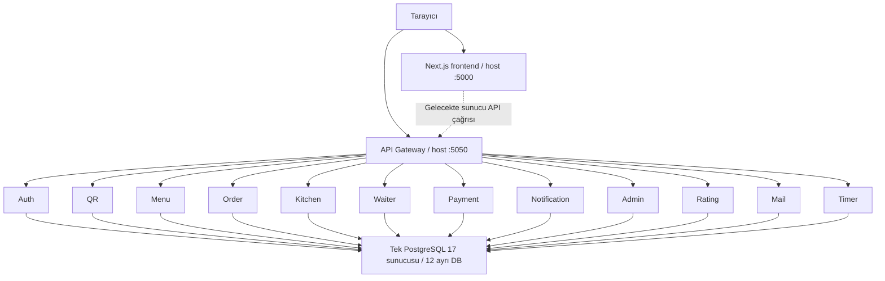
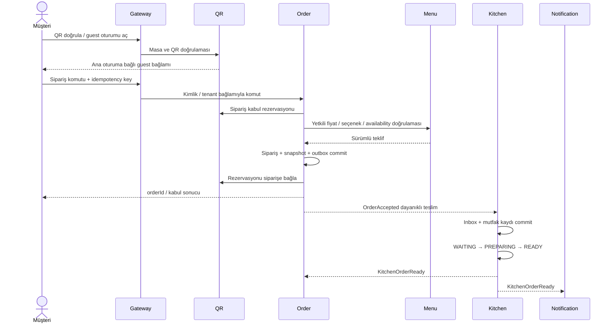
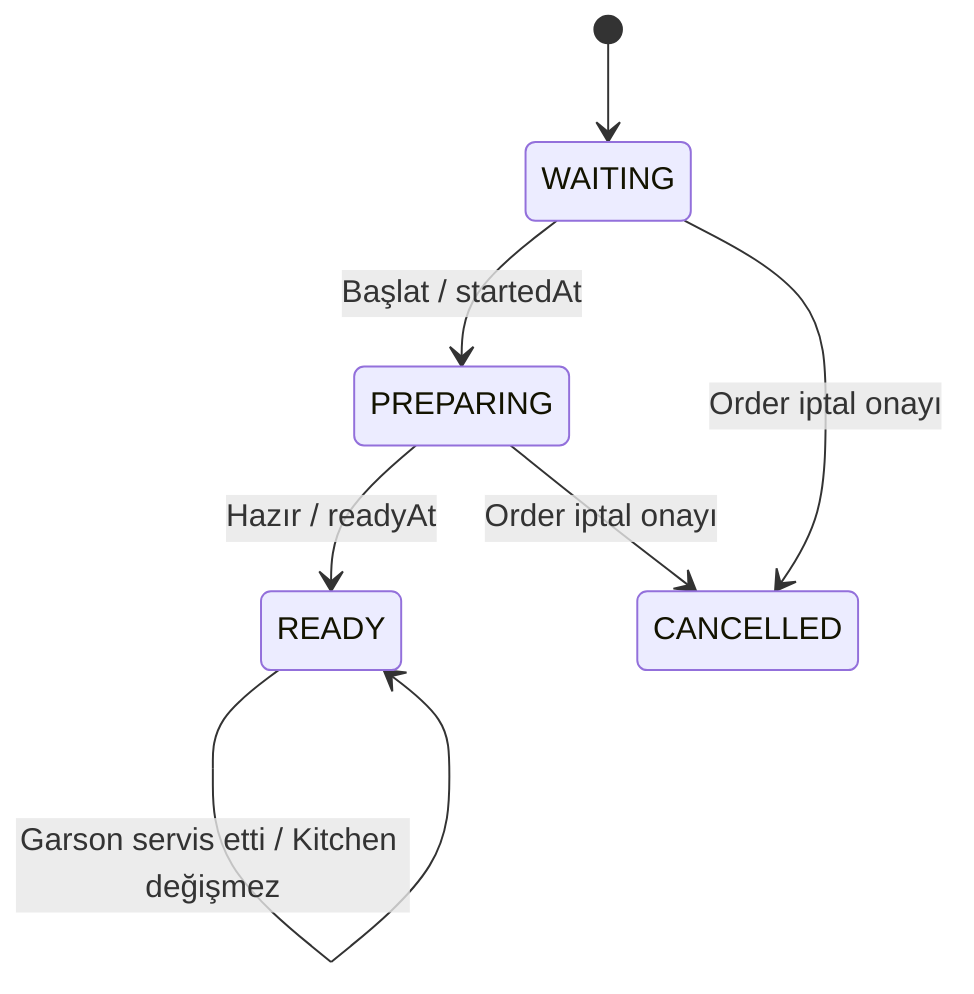

# Restofy — Mimari Analizi ve Hedef Tasarım

**Tarih:** 15 Ekim 2026. Kaynak: nihai gereksinim Word belgesi ve repository.  
**Durum:** Mevcut altyapı analizi + uygulanmamış mimari öneri. Kod, ENV, DB veya dağıtım ayarı değiştirilmedi.

İlgili belgeler: [gereksinimler ve açık kararlar](requirements.md), [veri modeli](database.md), [ER](er-diagram.md), [klasörler](folder-structure.md).

## 1. Mimari değerlendirme

Repository, tek frontend ve 13 backend modülünden oluşan mikroservis monorepo'sudur. API Gateway'in arkasında 12 veri sahibi servis vardır. Tek PostgreSQL sunucusu üzerinde ayrı veritabanları kullanılır; bu yapı tek paylaşımlı iş şeması değildir. Ayrı veritabanı tek başına güvenlik izolasyonu sağlamaz: Compose şu anda tüm veri servislerine aynı `POSTGRES_USER` ve `POSTGRES_PASSWORD` değerlerini geçirir.

Servis sınırları ürün gereksinimleriyle büyük ölçüde örtüşür; ancak işlevler henüz uygulanmamıştır. Üretim Java kodu 13 başlangıç sınıfı ve Order RestClient yapılandırmasından oluşur. Bu nedenle hedef akışların bugün çalıştığı veya mikroservisler arasında dağıtık tutarlılığın çözüldüğü söylenemez.

12 veri servisi erken aşamada önemli işletim maliyeti yaratır: bağlantı havuzları, hata telafisi, sözleşme sürümleri ve bağımsız migration yönetimi gerekir. Bu çalışma mevcut servis yapısını korur; daha fazla servis önermeden kritik akışların dikey olarak tamamlanmasını önerir.

## 2. Mevcut topoloji

Şema mevcut route/DB yapılandırmasını gösterir; tarayıcı iş çağrıları henüz uygulanmamıştır. Frontend'in API client'ı yoktur. Backend host portları Compose'ta `127.0.0.1` üzerinde yayınlanır: Auth 5051, Order 5052, Kitchen 5053, Waiter 5054, Menu 5055, QR 5056, Payment 5057, Notification 5058, Admin 5059, Rating 5060, Mail 5061, Timer 5062. PostgreSQL varsayılan host portu 5489'dur; portlar ENV ile değişebilir. Container iç servis portu varsayılan 8080'dir.

Gateway Web MVC kullanır; WebFlux tabanlı olduğu varsayılmamalıdır. Route'lar `/api/v1/{alan}` önekini korur; örneğin `/orders`, `/waiters`, `/payments` alanları çoğuldur, `/menu` ve `/qr` farklıdır. Gateway route varlığı alttaki iş endpoint'inin varlığını veya yetkilendirmeyi kanıtlamaz.

## 3. Servis sahipliği — önerilen sınırlar

### Auth

Personel kimliği, parola hash'i, restoran üyeliği/rol, iptal edilebilir auth oturumu, admin TOTP ve kurtarma. Guest masa oturumunun operasyonel sahibi QR; guest kimlik doğrulama sözleşmesi Auth ile birlikte tasarlanır. Siparişin müşteriye ait olup olmadığını yalnız Auth değil, kaynak sahibi servis de denetler.

### Admin

Restoran kaydı, zaman dilimi ve sipariş/ödeme yöntem ayarları. Yönetim ekranı bir erişim yüzeyidir; ürün Menu, masa QR, personel Auth üzerinden yönetilir. Admin başka servis veritabanına yazmaz. Rapor projeksiyonları kaynak olaylardan beslenebilir; finansal doğruluk Payment kayıtlarına dayanır.

### QR

Masa, masaya özel QR kimlik bilgisi, ana masa oturumu, guest oturumu, masa kapanışı ve idle expiry. Tek açık masa oturumu, tarama sayımı ve kapanış sırasında yeni siparişin engellenmesi bu sınırda koordine edilir. Üç saatlik Wi-Fi süresiyle karıştırılmaz.

### Menu

Kategori, ürün, içerik/seçenek, fiyat/vergi tanımı ve ürünün güncel satışa uygunluğunun tek yazarı önerilir. Kitchen ürün kapatma/açma yetkili komutunu Menu'ye iletir. Böylece iki servisin birbirinden farklı availability gerçeği tutması engellenir. Kitchen değişikliğin onayını almadan başarı göstermemelidir.

### Order

Sepet, fiyat snapshot'ı, sipariş kabulü, iptal kararları, teslim ve iş durumu. Kitchen'da hazırlık otoritesini, Payment'ta tahsilat otoritesini devralmaz. Kendi ekranları için sürümlü projeksiyon tutabilir. Bir siparişin iptaline mutfak değil Order karar verir.

### Kitchen

V1 sipariş bazlı hazırlık, salt okunur ürün/seçenek snapshot'ı, startedAt/readyAt, iptal talebi ve kesinleşmiş iptal tüketimi; manuel fire ve gün sonu mutfak sayımı. Servis teslimi Kitchen READY durumunu değiştirmez. Reçete, hammadde stoğu ve ürün bazlı hazırlık V1 kapsamı değildir.

### Waiter

Garson çağrıları, sahiplenme/çözüm ve restoran operasyon görünümü. Teslim isteğini Order'a, kapanış isteğini QR'a, restoranda ödeme teyidini Payment'a yönlendirir. Bu kayıtların ikinci iş otoritesi olmaz.

### Payment

Ödeme girişimi, sağlayıcı referansı/callback, yetkili personel teyidi, başarılı tahsilat, belirsiz sonuç ve uzlaştırma. İstemcinin “başarılı” sayfası ödeme kanıtı değildir. Gerçek sağlayıcı ve iade sözleşmesi açık karardır. Demo başarılı işlem gerçek tahsilat kaydıyla karıştırılmaz.

### Notification / Rating / Mail / Timer

- Notification: Olaydan rol/kişi hedefli bildirim, okundu bilgisi ve teslim durumu. Çağrının çözüldüğüne Waiter karar verir.
- Rating: Order/Payment'tan doğrulanan değerlendirme uygunluğu ve oy/puan özeti; nakit ödeme kuralı açık kalır.
- Mail: E-posta işinin gönderim/yeniden deneme takibi. Kimlik sırrı veya sıfırlama yetkisinin otoritesi değildir.
- Timer: Onaylanırsa Wi-Fi hakkı ve ağ adaptörü. QR idle expiry için Timer çalışıyor olması zorunlu değildir.

## 4. Senkron doğrulama ve dayanıklı olaylar

**Mevcut:** Statik servis URL'leri, Gateway yönlendirmesi ve Order RestClient timeout altyapısı. Broker, service discovery, SSE/WebSocket, outbox/inbox, retry dispatcher veya circuit breaker uygulaması bulunmadı.

**Öneri:** Kullanıcıya anlık kesin cevap gereken komut/doğrulamalar iç HTTP ile; commit sonrası bildirim/projeksiyonlar dayanıklı olay teslimiyle yürütülür. V1 için broker zorunlu tutulmadan veritabanı outbox + iç HTTP dispatcher değerlendirilebilir. Broker seçimi D-10'dur; Kafka/RabbitMQ varmış gibi tasarım yazılmamalıdır.

Her olay önerilen şu alanları taşır: `eventId`, `eventType`, `schemaVersion`, `occurredAt`, `restaurantId`, `aggregateId`, `aggregateVersion`, `correlationId`, `causationId`, gerekli minimum `payload`.

Üretici iş verisi ve outbox kaydını tek yerel transaction'da yazar. Dispatcher hedef başına teslim denemesini izler. Tüketici `(consumer_name,event_id)` tekilliğini, iş değişikliğini ve inbox kaydını aynı transaction'da commit eder. ACK commit'ten sonra gönderilir. Birden fazla hedef için tek global `published=true` alanı yeterli değildir.

Teslimat en az bir kez olabilir; “tam olarak bir kez ağ teslimi” iddiası kurulmaz. Aggregate version eski olayın yeni durumu ezmesini engeller. Sıra boşluğu varsa kısa retry sonrası sahibi servisten snapshot alınır. Hata kuyruğu/manuel uzlaştırma, deneme üst sınırı, backoff ve alarm tanımlanmalıdır. Olay payload'ları ham guest tokenı, parola veya kart verisi taşımaz.

Önerilen olay kataloğu:

- `OrderAccepted`: Order → Kitchen, Waiter, Notification, Admin. Sipariş/ürün snapshot'ı taşır.
- `KitchenPreparationStarted`: Kitchen → Order, Waiter; hazırlık projeksiyonunu ilerletir.
- `KitchenOrderReady`: Kitchen → Order, Waiter, Notification; kaynakta adı belirlenmiştir.
- `OrderCancellationRequested`: Kitchen/Waiter komutu Order'a; kesinleşmiş iptal olayı değildir.
- `OrderCancelled` / `OrderItemCancelled`: Order → Kitchen/Payment/Waiter/Notification/Admin. Kısmi iptal tüketimi D-02 sonrası.
- `ProductAvailabilityChanged`: Menu → ilgili görüntü/projeksiyonlar; Order checkout'ta otoriteyi ayrıca doğrular.
- `OrderServed`: Order → Waiter/Admin; Kitchen READY kalır.
- `PaymentSucceeded`: Payment → Order/QR/Rating/Admin/Notification; sadece doğrulanmış gerçek tahsilat.
- `TableSessionClosed`: QR → Waiter/Notification/Order; aktif listeler arşivlenir, geçmiş korunur.
- `WasteRecorded`: Kitchen → Admin rapor projeksiyonu.

## 5. Önerilen sipariş akışı

Bu akış uygulama önerisidir, mevcut kod davranışı değildir. Uzak HTTP çağrılarını uzun DB lock'ı altında tutmak yerine kısa yerel transaction ve açık koordinasyon tercih edilir.

### 5.1 Kapanış ve sipariş yarışı

Sadece “oturum açık mı?” GET'i yeterli değildir: kontrol ile Order commit'i arasında garson masayı kapatabilir. Önerilen `order_admissions`, QR'da idempotent bir kabul rezervasyonudur. Kapanış önce ana oturumu `CLOSING` yapar; yeni rezervasyon reddedilir. Mevcut rezervasyonların sonuçları Order'dan uzlaştırılmadan masa kapatılmaz.

Order commit olup QR teyidi kaybolursa rezervasyon zaman aşımıyla kör silinmez; sabit orderId/idempotency eşlemesiyle Order sorgulanır. Rezervasyon iptali ile geciken Order commit yarışı için version/fencing ve komut son tarihi gerekir. Bu koordinasyon uygulanmadan atomik kapanış garantisi verilemez. Basit bir kontrol + event yayını bu ihtiyacı karşılamaz.

### 5.2 Menü değişimi ve checkout yarışı

Menu'den fiyat/availability alınması başka servisteki commit ile atomik değildir. Öneri: Menü yetkili sürümlü/süreli teklif üretir, Order bu teklif anını fiyat geçerliliği sınırı kabul eder. “Kapatma anından sonra hiçbir kabul olamaz” şartı istenirse Menu tarafında ayrıca reserve/confirm/fencing protokolü gerekir. Kaynakta bu dağıtık yarışın kesin zaman sınırı verilmediği için garanti uydurulmaz.

Kitchen stokta yok durumunda mevcut kesinleşmiş siparişi geriye dönük değiştirmez; iptal talebi Order'a gider.

## 6. Bağımsız durum makineleri

### Mutfak — normatif

READY'den iptal normal V1 geçişi değildir; sınır D-02'de kesinleştirilir. İptal talebi ayrı kayıttır, durum geçişi değildir.

### Diğer yaşam döngüleri — öneri

- **Sipariş işi:** `ACCEPTED`, `PARTIALLY_CANCELLED`, `CANCELLED`, `COMPLETED`. Tamamlanma için teslim/iptal ve ödeme koşulları birlikte değerlendirilir.
- **Teslim:** `PENDING`, `SERVED`; iptal edilen sipariş SERVED yapılamaz.
- **Ödeme girişimi:** `PENDING`, `SUCCEEDED`, `FAILED`, `CANCELLED`, teknik belirsizlik için `UNKNOWN`. Siparişin ödeme özeti girişimlerin sonucu ve tahsilattan türetilir.
- **Ana oturum:** `OPEN`, `CLOSING`, `CLOSED`, `EXPIRED`.
- **Masa temizliği:** `AVAILABLE`, `OCCUPIED`, `CLEANING`, `DISABLED`.
- **Çağrı:** `OPEN`, `CLAIMED`, `RESOLVED`, `CANCELLED`; alıcı “okundu” durumu ayrı.

“Hazır → servis → ödeme” ekran sırası ön ödeme seçeneğini engelleyen tek enum'a dönüştürülmez. Ödeme başarılı olsa da mutfak hazırlığı sürüyor olabilir.

## 7. İptal, ödeme ve uzlaştırma

Kitchen iptal talebi neden ve gerektiğinde ürün referansı içerir. Order mevcut iş/teslim/ödeme durumunu ve yetkiyi denetler; talebi kabul veya reddeder. Kesinleşen iptal geçmişe eklenir ve olay üretilir. Kitchen yalnız bu olayı uyguladıktan sonra CANCELLED olur.

Payment başarısı ile Order iptali birbirinden bağımsız transaction'lardır. İptal sonrası gecikmiş başarılı callback gerçek para alındıysa kaydı korunur ve manuel/otomatik uzlaştırma gerektirir; “sipariş iptal, callback'i yok say” yaklaşımı uygun değildir. İade kapsamı kesinleşmeden refund API veya otomatik iade vaadi verilmez. İlk sürümde ödenmiş sipariş iptalini yetkili incelemeye alma önerisi D-01/D-02 ile kararlaştırılır.

Ödeme başlatılırken sunucunun belirlediği tutar/para birimi/order referansı kullanılır. Ödeme yöntemi değişikliği ikinci tahsilat üretmemeli; tek aktif girişim ve tek başarılı settlement kısıtları kullanılmalıdır. Sağlayıcıya gönderilmiş fakat cevabı kayıp istek `UNKNOWN` olarak uzlaştırılır; yeni anahtarla tekrar tahsilat başlatılmaz.

Demo sağlayıcı ayrı mod/namespace ile işaretlenir; üretimde açılmaz. Demo başarılı kaydı gerçek `payment_settlements` tablosuna yazılmaz; gerçek ciro, değerlendirme ve masa ödeme koşullarına etkisi test politikasında açıkça tanımlanır.

## 8. Gerçek zamanlı ekranlar

SSE veya WebSocket henüz seçilmemiştir. Tek yönlü bildirim için SSE, etkileşim gereksinimi varsa WebSocket değerlendirilebilir; bu öneri uygulama değildir. İlk sürümde kontrollü polling de yeterli olabilir.

İlk açılışta yetkili snapshot, sonra olay/delta; kopma sonrası son sürüm/cursor ile tekrar senkronizasyon önerilir. Olay geçici UI bildirimi olabilir, kalıcı iş gerçeği sahibi servistedir. Kanal abonelikleri tenant + rol + kaynak sahipliğiyle sınırlandırılır; frontend'in gönderdiği restaurantId tek başına kanal yetkisi değildir. Gateway MVC/timeout kapasitesi seçilen uzun bağlantı yaklaşımıyla ayrıca doğrulanır.

## 9. Güvenlik ve güven sınırları

`docs/SECURITY.md` bu tasarımın yerel güvenlik dayanağıdır. Auth yöntemi kesinleşmeden cookie/JWT akışı uygulanmış sayılmaz.

- Gateway dış kimlik doğrulama ve hız limiti katmanı olabilir; kaynak sahibi servis rol/tenant/nesne yetkisini ayrıca doğrular.
- Kullanıcıdan gelen `X-Restaurant-Id` veya rol header'ına güvenilmez. Proxy kimlik header'ları temizlenir; servisler arası kimlik kriptografik veya eşdeğer güvenilir mekanizmayla doğrulanır.
- Guest yetkisi belirli ana/guest oturumuna bağlıdır. Masa numarası veya QR linkini bilmek tüm masanın geçmişine erişim sağlamaz.
- Tarayıcı auth tokenı localStorage/sessionStorage/IndexedDB'ye kalıcı yazılmaz. Cookie kararında CSRF ve güvenli cookie özellikleri birlikte tasarlanır.
- QR doğrulama, login, sipariş ve ödeme farklı rate-limit profilleri taşır. Ham token/özel linkler loga, analitiğe ve metadata'ya konmaz.
- Mail ve Timer route'larının Gateway'de bulunması bunların public olması gerektiği anlamına gelmez. İç komutlar dış erişime kapatılmalı; sağlayıcı webhook'u ayrı imza/replay doğrulaması kullanmalıdır.
- Production'da backend DB/servis portları internete açılmaz. Ayrı servis DB rolleri gerekir; bu çalışma yeni DB kullanıcısı veya ENV oluşturmadı.

Bu belge penetrasyon testi, güncel bağımlılık açığı taraması veya hukuki uygunluk onayı değildir.

## 10. Raporlama ve tarih

Admin paneli kaynak DB'ler arasında SQL JOIN yapmaz. Küçük kapsamda yetkili API aggregation, hacim büyüdüğünde olaydan idempotent rapor projeksiyonu önerilir. Raporların son senkronizasyon zamanı görünür olmalıdır.

Mutfak sayımları Kitchen'dan; doğrulanmış tahsilat Payment'tan; sipariş/satış/iptal Order'dan; masa yoğunluğu QR'dan; değerlendirme Rating'den gelir. Para toplamları para birimine göre ayrılır. “Kazanç” ürün maliyetleri olmadan kâr diye etiketlenmez.

Zamanlar `timestamptz` ile mutlak an olarak tutulur; servisler UTC kullanır. İş günü restoran IANA saat diliminde `[gün başı, ertesi gün başı)` aralığıyla UTC'ye çevrilir. Mevcut frontend tarih biçimi Europe/Istanbul'dur; çok restoran tasarımında restoran saat dilimi ayrıca tutulmalıdır.

## 11. Test, işletim ve riskler

Mevcut kanıtlar Gateway HTTP route/downstream test kodu, Order RestClient transport/timeout test kodu, Menu Flyway/PostgreSQL test kodu ve frontend i18n/tarayıcı testleridir. Bu incelemede testler çalıştırılmadı. İş akışı ve yetki testleri mevcut altyapı testlerinin yerine geçmez.

Uygulamada gerekli ek kontroller: tenant/rol/guest sahipliği, çift sipariş, callback tekrarı, iptal/ödeme/kapanış yarışları, olay sırası/tekrarı, servis kesintisi ve geri yükleme. Manuel pre-push komutu repository'deki `pre-push/pre-push.md` rehberinden izlenir; SonarQube ayrı ve isteğe bağlıdır.

Başlıca mimari riskler:

1. **Auth ve tenant uygulamasının yokluğu:** İş endpoint'lerinden önce güven sözleşmesi ve olumsuz yetki testleri.
2. **Dağıtık kapanış/checkout yarışı:** Rezervasyon, fencing ve uzlaştırma uygulanmadan atomiklik vaadi verilmemesi.
3. **Ortak DB kimliği:** Ayrı kullanıcı/izin ve migration/runtime rol ayrımı.
4. **Olay taşıyıcısının yokluğu:** Outbox + tüketici tekilliği; sonlu retry ve hata görünürlüğü.
5. **Ödeme belirsizliği:** Sağlayıcı, iade, UNKNOWN ve demo/gerçek ayrımı.
6. **Erken mikroservis maliyeti:** 12 havuz için varsayılan üst sınır toplamı 60 bağlantıdır; buna migration/test/operasyon bağlantıları da eklenir. Kapasite ölçülmelidir.
7. **Belirsiz ürün kararları:** `requirements.md` D-01–D-15 kapanmadan ilgili davranışın tamamlandı sayılmaması.

Deployment, broker, yeni ENV, migration ve güvenlik sözleşmesi değişiklikleri bu analiz tesliminin kapsamına dahil değildir. Tasarımı uygulamaya alma ayrı çalışmadır.
