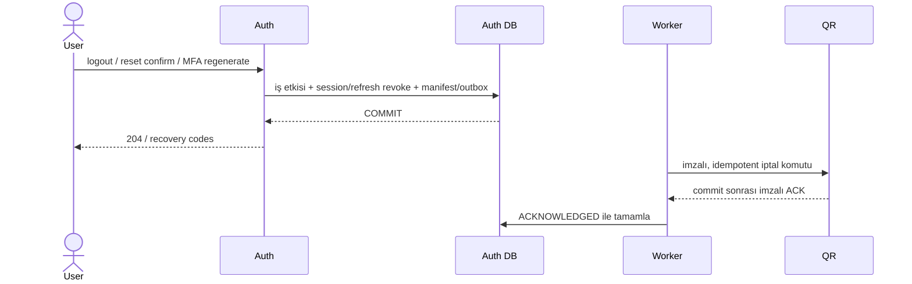
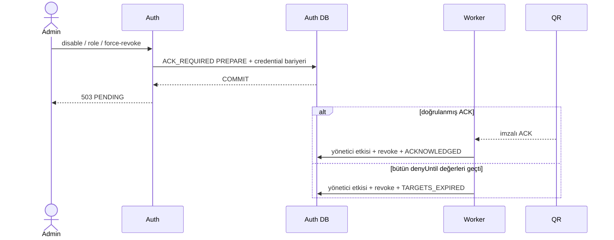

# Q5 Auth–QR sözleşmesi

Bu belge Q5 erişim iptali eklerini tanımlar. Normal QR personel istekleri Auth'a HTTP çağrısı yapmaz; QR, staff JWT'sini ve kendi primary PostgreSQL veritabanındaki kalıcı SID engelini denetler.

## Politika matrisi

| İşlem | Politika | Auth cevabı | Credential bariyeri |
| --- | --- | --- | --- |
| Logout | `LOCAL_FIRST` | Yerel commit ve cookie temizliği sonrası 204 | Hayır |
| Password reset confirm | `LOCAL_FIRST` | Parola, reset kaydı, oturum iptali ve teslimat kaydı aynı transaction'da commit edilirse 204 | Hayır |
| MFA recovery-code regenerate | `LOCAL_FIRST` | Aktör oturumu korunur; diğer oturumlar ve teslimat kaydı commit edildikten sonra kodlar döner | Hayır |
| Geçersiz/replay/inactive session temizliği | `LOCAL_FIRST` | Yerel güvenlik etkisi hemen uygulanır | Hayır |
| Hesap pasifleştirme, rol değişikliği, yönetici force-revoke | `ACK_REQUIRED` | QR ACK veya bütün hedef JWT'lerin sona ermesinden önce başarı yok; 503/PENDING | Evet |

`LOCAL_FIRST` için iş değişikliği, session/refresh iptali, immutable SID manifesti ve durable teslimat kaydı tek Auth transaction'ındadır. Outbox yazılamazsa iş etkisi de rollback olur. QR kesintisi commit edilmiş yerel işlemi 503'e çevirmez.

`ACK_REQUIRED` PREPARE, aynı kullanıcı kilidi altında yeni login/refresh/MFA credential üretimini durdurur. QR'ın imzalı ACK'i doğrulandığında veya manifestteki en büyük `denyUntil` geçtiğinde yerel yönetici etkisi finalize edilir. Hedef yoksa sonuç doğrudan `NO_TARGETS` olur.

Logout sıkı işlem sırasında da yerel tamamlanır. Sıkı manifest logout SID'sini kapsıyorsa yeni teslimat oluşturulmaz; kapsamıyorsa ayrı idempotent `LOCAL_FIRST` teslimatı kaydedilir. Password reset ve MFA regeneration sırasında sıkı işlem varsa 503/PENDING korunur.

## Akışlar

## HTTP ve hata davranışı

- `POST /api/v1/auth/logout`: yerel commit sonrası 204; Auth cookie'lerinin tamamı temizlenir. QR kesintisi 503 üretmez.
- Password reset confirm: atomik yerel commit sonrası 204 ve cookie temizliği.
- MFA recovery-code regenerate: aktör SID korunur, diğer SID'ler iptal edilir.
- QR'da invalid/expired JWT veya iptal SID 401; doğrulanmış kimliğin rol/CSRF reddi 403; guard/DB/readiness kesintisi 503'tür.
- Endpoint, request DTO ve public path değişmez.

## Internal komut ve ACK

`POST /internal/q5/revocations` komutu `operationId, restaurantId, userId, revision, generation, targets[{sessionId,denyUntil}]` taşır. Dedicated RS256 servis JWT'si `iss=auth-service`, `aud=restofy-qr-revocation`, `scope=staff:revocation:write` kullanır ve en çok 30 saniyedir.

QR, SID engelleri ile operation/digest kaydını aynı primary DB transaction'ında commit eder; receipt'i yalnız commit sonrasında imzalar. Auth receipt'te issuer, audience, scope, operation, restoran, generation ve canonical manifest digest'ini doğrular. HTTP 200 tek başına ACK değildir. Duplicate ve ters sıralı teslimatlar mevcut SID engellerini kaldıramaz.

Bootstrap challenge/baseline, fail-closed readiness, restore nonce'u ve public gateway izolasyonu korunur. Production HTTPS ve gerçek anahtar provisioning deployment sorumluluğudur.

## Veri ve worker durumu

`staff_revocation_operations` V8 ile `completion_policy`, `local_applied_at` ve `delivery_outcome` alanlarını taşır. Sonuçlar `ACKNOWLEDGED`, `TARGETS_EXPIRED`, `NO_TARGETS` olabilir. Yalnız aktif `ACK_REQUIRED` kayıtları credential bariyerine girer.

PostgreSQL worker `FOR UPDATE SKIP LOCKED`, 30 saniyelik lease ve en çok 8 kayıtlık batch kullanır. HTTP açık DB transaction'ında yapılmaz. Pending sayı/yaş, retry sınıfı ve tamamlanma sonucu hassas veri içermeyen loglarla izlenir. Guard ve geçmiş kayıtlar otomatik silinmez.

## 300 saniyelik sınır

Personel access-token TTL'si 300 saniyedir. Manifest `denyUntil`, session refresh ömrüyle değil, en fazla hazırlık zamanı + access TTL ile sınırlandırılır. QR ACK alınamazsa worker bu son tarihten önce finalize etmez.

Frontend silent refresh **NOT IMPLEMENTED**. Bu PR gerçek tarayıcıda kesintisiz beş dakikalık yenileme deneyimi veya Auth kesintisine dayanıklı frontend vaat etmez.

Restore sırası için [Q5 restore runbook](q5-restore-runbook.md) zorunludur.
