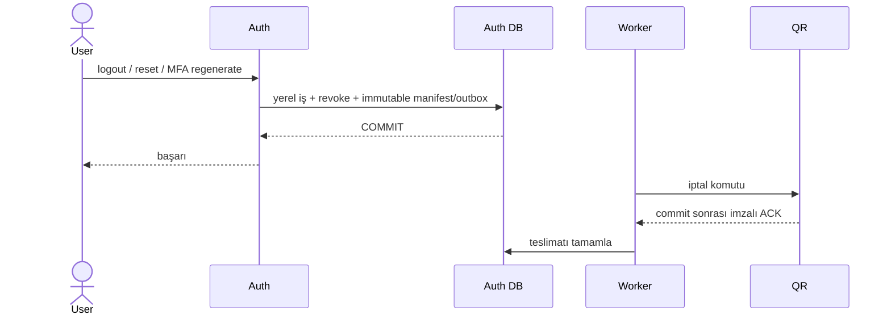
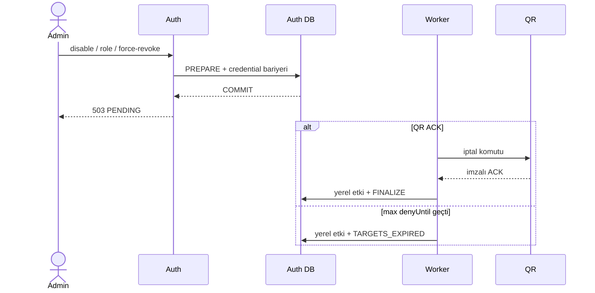

# ADR-AUTH-Q5 — Koordineli personel erişimi iptali

Durum: Draft PR için revize edildi; teknik inceleme ve test kanıtı tamamlanmadan kabul edilmiş sayılmaz.

## Bağlam

QR, personel JWT'lerini yerel doğrular. Auth'ta iptal edilen bir oturumun daha önce verilmiş access JWT'si kriptografik olarak süresi dolana kadar geçerli kalabilir. Her QR isteğinde Auth introspection çağrısı istenmiyor; QR'ın kalıcı SID engeli, RBAC, restoran izolasyonu ve fail-closed kontrolü korunmalıdır.

Önceki tasarım logout, password reset ve MFA recovery-code yenilemeyi QR ACK'e bağlayarak QR kesintisini kullanıcı işlemlerinde 503'e dönüştürüyordu. Bu kullanılabilirlik bağımlılığı kabul edilmedi.

## Karar

İki tamamlanma politikası kullanılır:

| Politika | İşlemler | Yerel etki | Tamamlanma |
| --- | --- | --- | --- |
| `LOCAL_FIRST` | logout, reset confirm, MFA recovery-code regenerate, otomatik session temizliği | İş etkisi + session/refresh iptali + durable teslimat tek Auth transaction'ında | QR ACK veya hedef JWT'lerin sona ermesi |
| `ACK_REQUIRED` | hesap pasifleştirme, rol değişikliği, yönetici force-revoke | PREPARE yalnız manifest ve credential bariyerini commit eder | QR ACK veya hedef JWT'lerin sona ermesiyle yönetici etkisi uygulanır |

Personel access-token TTL'si 300 saniyedir. Bu, QR ulaşılamadığında kabul edilen en kötü eski-token penceresidir. `denyUntil`, hazırlık zamanı + 300 saniye ile session mutlak son tarihinin minimumudur.

### LOCAL_FIRST

Pending `LOCAL_FIRST` kayıtları yeni login/refresh/MFA grant üretimini engellemez. Eski Auth session/refresh zaten yerel olarak iptal edilmiştir. Outbox insert başarısızsa aynı transaction'daki iş etkisi rollback olur.

### ACK_REQUIRED

Pending `ACK_REQUIRED` kayıtları yeni credential üretimini ve Auth authentication'ını kapatır. Hedef yoksa güvenli sonuç `NO_TARGETS` ile hemen tamamlanır. Kullanıcı logout'u sıkı işlem sırasında yine yerel tamamlanabilir; reset/MFA regeneration güvenlik önceliğiyle pending kalır.

## Protokol değişmezleri

- Auth kullanıcı kimliğini kilitlemeden manifest oluşturmaz veya credential üretmez.
- Normal QR isteğinde Auth HTTP çağrısı yoktur.
- Servisler arası HTTP açık DB transaction'ında yapılmaz.
- QR primary DB'de SID engeli ve idempotency kaydını birlikte commit eder; ACK yalnız commit sonrasında imzalanır.
- Auth yalnız exact manifest/generation için doğrulanmış receipt'i kabul eder.
- QR SID engelleri birleşimlidir; duplicate veya ters sıralı komut eski engeli kaldıramaz.
- QR DB/guard/readiness kullanılamıyorsa personel trafiği 503 ile fail-closed olur.
- PostgreSQL worker `SKIP LOCKED` ve lease ile çalışır; crash ve ACK kaybında aynı immutable manifest yeniden gönderilir.

## Karşılaştırılan seçenekler

PR #18 incelemesinde istenen karşılaştırma. Ölçüt: tek restoranlı MVP için güvenlik, kullanılabilirlik ve servis sayısı arttıkça bağımlılığın büyümemesi.

| Seçenek | Güvenlik | Kullanılabilirlik / bağımlılık | Sonuç |
|---|---|---|---|
| A. Her QR isteğinde Auth'a sorgu (introspection) | Anlık iptal | Auth kesintisi bütün QR trafiğini durdurur; her istekte ağ gecikmesi | Reddedildi |
| B. Yalnız kısa token ömrü (300 sn), koordinasyon yok | Eski token en çok 300 sn geçerli; yönetici işleminin ne zaman etkili olduğuna dair kanıt yok | En basit; hiçbir bağımlılık yok | Yetersiz: pasifleştirme/rol kaldırma için kanıt gerekir |
| C. Her iptal işlemi QR onayına bağlı (önceki tasarım) | En güçlü | QR çökünce kimse çıkış yapamaz, parola/MFA sıfırlanamaz; yeni servisler aynı garantiyi isterse hepsinin ayakta olması gerekir | Reddedildi |
| **D. Karma (seçilen)** | Yönetici işlemleri kanıtlı; kullanıcı işlemlerinde pencere en çok 300 sn | Kullanıcı işlemleri hiçbir servise bağlı değil; bağımlılık yalnız yönetici işleminde ve yalnız geçici | **Seçildi** |

Seçim gerekçesi:

- **Tehdit farkı.** Kullanıcının kendi çıkışı, parola ve MFA yenilemesi düşük risklidir; kullanıcı zaten oturumu kendisi bitiriyor. Hesap pasifleştirme ve rol kaldırma ise çalınmış hesap veya işten çıkarma gibi yüksek riskli durumlardır; bunlar için başarı ancak QR onayı veya token süresinin dolmasıyla bildirilir.
- **Garanti kaybı yok.** SID engeli, RBAC, restoran izolasyonu ve fail-closed davranışı (QR DB/guard kullanılamıyorsa 503) korunur. Değişen yalnız kullanıcı işlemlerinin QR onayını beklememesidir.
- **Ölçeklenme.** Yeni bir servis personel JWT'sini doğrulamaya başladığında bir personelin çıkış yapabilmesi o servisin ayakta olmasına bağlı olmaz.
- **Maliyet.** Eski token en çok 300 saniye kabul edilebilir ve tarayıcı deneyimi için frontend'de silent refresh gerekir (aşağıda).

## Sonuçlar ve kabul edilen maliyet

Logout/reset/MFA QR kesintisinden bağımsızlaşır. Buna karşılık QR eski access JWT'sini ACK gelene veya en çok 300 saniyelik TTL dolana kadar kabul edebilir. Yönetici müdahaleleri bu pencere bitmeden başarılı gösterilmez.

Yeni broker eklenmez. Guard/history retention otomatik değildir. Production TLS, gerçek anahtar dağıtımı ve restore tatbikatı bu ADR ile tamamlanmış sayılmaz.

Frontend silent refresh **NOT IMPLEMENTED**. Access TTL'nin 300 saniyeye düşmesi gerçek tarayıcı deneyiminde ayrıca frontend entegrasyonu gerektirir.

## Restore

Restore öncesinde personel ingress'i ve Auth/QR süreçleri durdurulur. Restore sonrasında `ops/qr/q5-restore-quarantine.sql` yeni nonce üretip guard'ı kapatır. Güncel tam baseline ve Auth source ACTIVE doğrulanmadan trafik açılmaz. Habersiz DB/VM rollback otomatik kurtarma kapsamında değildir.

## Doğrulama ölçütleri

- QR kapalıyken LOCAL_FIRST işlemleri yerel atomik başarı verir.
- Outbox hatası bütün yerel işi rollback eder.
- ACK_REQUIRED yeni credential üretimini kapatır ve erken başarı vermez.
- ACK, ACK kaybı, Auth crash'i, iki worker, duplicate/ters sıra ve `TARGETS_EXPIRED` yolları test edilir.
- QR imza, generation, tenant, RBAC, restore/bootstrap ve fail-closed regresyonları korunur.
