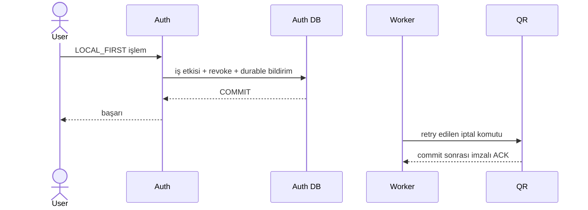
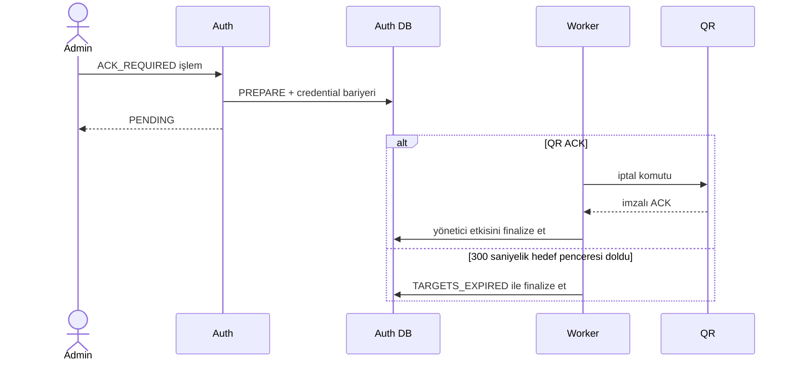

# ADR-QR-003 — QR ve Auth entegrasyonu

- **Durum:** Q3.1/Q7/Q8/Q9 için 5 Kasım kararları korunur. Q5 güncel iptal gereksinimine ve Q1–Q4 etkilerine Kerem, Draft PR #18'de koordineli kalıcı iptal çözümüyle yanıt verdi. Alper yaklaşımı olumlu değerlendirdi; QR uygulamasının teknik değerlendirmesi ile PR/reviewer onayı bekleniyor. Yanıtın sunulması, bütün uygulama ayrıntılarının kabulü veya kodun dev'e alınması değildir.
- **Oluşturulma:** 1 Kasım 2026. **Son güncelleme:** 9 Kasım 2026.
- **Hazırlayan:** Alper — QR / Payment sorumlusu. **Auth yanıtı:** Kerem Kalyoncu.
- **Numaralandırma:** Önceki adı `ADR-QR-AUTH-001-qr-auth-entegrasyonu.md` idi. Reviewer'ın aynı QR sırasını kullanma önerisiyle ADR-QR-003 olarak düzenlendi; [ADR-QR-002](ADR-QR-002-security.md) müşteri güvenliğini ele alır.
- **Kapsam:** Personel JWT/cookie, güncellik ve iptal sınırı, CSRF, restoran/RBAC sorumluluğu ve küçük uygulama PR'ları.

Bu belge yanıt, öneri, kabul edilmiş QR kararı ve uygulanmış kodu ayrı gösterir. PR #17, `3761324` ile dev'e alınan önceki ADR kararlarının kaydıdır. Q5 kodu Draft PR #18'dedir; bu ADR güncellemesi uygulamayı onaylamaz, PR'ı kapatmaz veya endpoint'leri production'a açmaz. Nihai revizyon; Auth kodu, V8 migration, test/ENV varsayılanları, ağ kabul senaryosu ve belgeleri birlikte günceller.

## 1. Review kaynakları ve kapsam

- [Hocanın 2 Kasım review'ı](https://github.com/software-lecture-labs/Restofy/pull/17#pullrequestreview-5743201623): Guest cookie kararı Order/Waiter'ı etkiliyor; K3 ortak karar bekleyen öneri olmalı. Uygulama belleği + Bearer alternatifi de değerlendirilmeli. İki ADR aynı QR numara sırasına alınmalı.
- [Kerem'in 4 Kasım yanıtı](https://github.com/software-lecture-labs/Restofy/pull/17#issuecomment-6634331755) ve [0356bb5'teki Q1–Q9 belgesi](https://github.com/software-lecture-labs/Restofy/blob/0356bb530cd37c83a2142fc8b5fe44004e8ee99c/docs/auth-service/qr-auth-integration-response.md).
- [Aynı commit'teki staff-v1 sözleşmesi](https://github.com/software-lecture-labs/Restofy/blob/0356bb530cd37c83a2142fc8b5fe44004e8ee99c/docs/auth-service/staff-contract.md): JWT/cookie/CSRF üretici ve tüketici davranışları.

Kerem'in yanıtı ve staff-v1 GitHub üzerinden salt okunur incelendi; Auth dalı çekilmedi. Yerel karşılaştırma PR #17 başı `19be5ae` üzerindeki Auth/QR/Order kaynaklarıyla yapıldı. Uzak belgenin veya test isimlerinin bulunması QR entegrasyonunun çalıştığını kanıtlamaz. Yerelde bulunmayan Auth dokümanlarına yukarıda sabit commit bağlantısı verildi.

[ADR-AUTH-001](ADR-AUTH-001-mail-gonderimi.md) Auth → Mail teslimini, [ADR-AUTH-002](ADR-AUTH-002-rate-limit-ve-kilitler.md) Auth limit/kilitlerini ele alır; bu çalışma onların kararlarını veya Auth kodunu değiştirmez.

### 6 Kasım Q5 yanıtı ve uygulama kaydı

- [Draft PR #18](https://github.com/software-lecture-labs/Restofy/pull/18): Auth–QR uygulaması ve test sonuçları; bu ADR güncellemesinden önceki kod başı `d063fd6`.
- [Kerem'in QR sahipliği ve inceleme sınırı](https://github.com/software-lecture-labs/Restofy/pull/18#issuecomment-6667427175) ve [Alper'in teknik değerlendirme yapacağını belirten yanıtı](https://github.com/software-lecture-labs/Restofy/pull/18#issuecomment-6671475409).
- [Q5 teknik ADR'si](ADR-AUTH-Q5-coordinated-revocation.md) ve [internal/HTTP sözleşmesi](../auth-service/q5-contract.md).

Bu kaynaklar önceki “Kerem'den revizyon bekleniyor” durumunu yanıt sunuldu olarak günceller. QR sorumlusu Alper'in kod değerlendirmesi ile öğretim görevlisi/PR onayı ayrıca beklenir.

## 2. Dev kaynak durumu ve önceki öneriden fark

Aşağıdaki maddeler ilk incelemenin dev kaynak durumunu ve salt yerel JWT önerisini kaydeder. Q5 için güncel revize yanıt Q1–Q5'tedir; PR #18'deki uygulama dev'e merge edilmiş sayılmaz.

- [StaffJwtTokens](../../backend/services/auth-service/src/main/java/com/restofy/auth/infrastructure/security/StaffJwtTokens.java) RS256 access JWT üretir. Auth kendi [StaffSessionService](../../backend/services/auth-service/src/main/java/com/restofy/auth/application/service/StaffSessionService.java) kontrolünde ayrıca kullanıcı aktifliği, güncel rol, oturum iptali ve idle/mutlak süreyi denetler.
- [AuthCookies](../../backend/services/auth-service/src/main/java/com/restofy/auth/infrastructure/security/AuthCookies.java): `restofy_access` Path `/api/v1`; refresh/MFA Path `/api/v1/auth`. Access HttpOnly; cookie'ler host-only, SameSite Lax ve production'da Secure'dür.
- Alper'in ilk önerisi her istekte güncel Auth oturum kontrolüydü. **Kerem bunun yerine mevcut staff-v1'i koruyarak yerel JWT doğrulaması önerdi.** Bu nedenle yeni introspection, onun servis credential'ı, uzak timeout ve olumlu sonuç cache'i bu önerinin parçası değildir.
- Yerel JWT doğrulaması Auth'un güncel DB kontrolüne eşdeğer değildir. QR hesabın sonradan pasifleştirildiğini, rolün değiştiğini, oturumun iptal/idle nedeniyle kullanılamaz olduğunu doğrudan öğrenmez; imzalı tokenı en fazla geçerli access süresi içinde kabul edebilir. **Alper bu kalan-TTL erişim penceresini kabul etmedi.** Kerem'in ilk yanıtı tarihsel dayanak olarak korunur; hedef tasarım Q5'teki revize yanıtla güncellendi; ilk TTL önerisi tarihsel dayanak olarak kalır.
- [QR HTTP sınırı](../../backend/services/qr-service/src/main/java/com/restofy/qr/infrastructure/security/TableSecurityConfiguration.java) sağlık dışında denyAll kalır; gerçek staff verifier/principal/yetki adaptörü henüz eklenmedi.

## 3. Q1–Q9: Kerem'in yanıtları ve kalan kararlar

### Q1 — Personel ve güncel iptal bilgisi hangi kanıtla doğrulanacak?

**Revize Auth yanıtı — PR #18:** Normal QR personel isteğinde Auth'a HTTP çağrısı yoktur. QR, `restofy_access` JWT'sini yerel olarak doğrular; ayrıca kendi primary PostgreSQL veritabanındaki kalıcı SID engelini ve güvenli bootstrap/readiness durumunu kontrol eder. Bu, yalnız JWT'nin kalan TTL'sine güvenen ilk önerinin yerine geçer.

QR principalı doğrulanmış `sub`, `sid`, `jti`, `role`, `restaurant_id`, `auth_state=AUTHENTICATED`, `token_type=access` alanlarına dayanır. Header/body içindeki serbest kimlikler kanıt değildir. Refresh/MFA credential'ı QR personel kimliği üretmez. İptal komutu personel isteğinden ayrı, Auth → QR internal akışıdır; ayrıntılar Q2/Q5'tedir.

**Durum:** PR #18'de yanıtlandı ve uygulandı; QR teknik değerlendirmesi/PR onayı bekleniyor. Normal personel isteği için yeni public introspection endpoint'i önerilmiyor.

### Q2 — İptal akışında servis kimliği nasıl doğrulanacak?

**Revize Auth yanıtı — PR #18:** Çağrı yönü Auth → QR'dır. Auth, personel JWT'sinden ayrı RSA command anahtarıyla kısa ömürlü RS256 servis credential'ı imzalar. QR ayrı receipt anahtarıyla kalıcı ACK imzalar; Auth bu public key ile doğrular. İç ağ veya serbest `X-Service-Name` güven kaynağı değildir.

- Command: `iss=auth-service`, `aud=restofy-qr-revocation`; iptal için `staff:revocation:write`. Bootstrap challenge/write ayrı scope'lar kullanır.
- Receipt: `iss=qr-service`, `aud=restofy-auth`, `scope=staff:revocation:ack`; bootstrap ACK'i ayrı scope kullanır.
- Operation, restoran, generation ve tam manifest digest'i eşleştirilir; bootstrap nonce'a da bağlıdır. RS256, 2048+ bit anahtar ve en fazla 30 saniyelik credential/receipt ömrü uygulanır.
- `POST /internal/q5/challenge`, `/bootstrap`, `/revocations` public gateway tarafından route edilmez; QR body işlenmeden servis kimliğini doğrular. Cookie/Origin taşıyan browser çağrısı ve personel JWT'si reddedilir. Production HTTPS gerektirir.

Personel signing private key'i ve CSRF/MFA/reset sırları QR'a verilmez. Staff public key kaynağı Q7'de korunur; yeni command/receipt çiftleri yalnız servis kimliği içindir. Wire ve ENV alanları [Q5 sözleşmesindedir](../auth-service/q5-contract.md).

**Durum:** PR #18'de yanıtlandı ve uygulandı; dedicated servis anahtarlarının dağıtımı/TLS ve QR sahipliği incelemesi tamamlanmış sayılmaz. Order/Payment/Waiter delegasyonu bu dar sözleşmeyle çözülmez.

### Q3 — Hangi oturum, kullanıcı, rol ve restoran bilgileri doğrulanacak?

**Revize Auth yanıtı — PR #18:** Yalnız RS256; yapılandırılmış issuer; `restofy-staff-api` audience; access + AUTHENTICATED; zorunlu ve tutarlı `exp/iat/nbf`; UUID `sub/sid/jti`; rol allowlist'i, restoran eşleşmesi ve en fazla 4096 karakter token doğrulanır. `staff-v1` sözleşme adıdır; buna karşılık güvenli eski-token geçişi için `auth_policy=q5-idle-v1` claim'i gerçekten eklenmiştir.

QR her personel kontrolünde yerel kalıcı SID engelini denetler. Auth hesap pasifleştirme/rol kaldırma sözleşmesinde ilgili eski session'ları koordineli iptal eder; QR güncel Auth rolünü DB'den okumaz. Eski rol taşıyan JWT, FINALIZE sonrasında SID engeli nedeniyle yetki veremez. Dev'de olmayan personel yönetimi endpoint'leri PR #18'e taşınmadı; ilgili servis entegrasyon noktası hazırlandı.

`ADMIN`, `WAITER`, `KITCHEN` hiyerarşik değildir. Q3.1 matrisi, restoran ve hedef masa/oturum/QR sahipliği kontrolleri ayrı uygulanır. MFA_PENDING, refresh, guest veya service credential personel principalı üretmez. Access TTL artırılmadı; JWT süresi configured TTL, absolute ve mevcut idle son tarihlerinin minimumudur. QR okuması/polling idle süresini yenilemez.

**Durum:** PR #18'de yanıtlandı; 17 personel method/path için uygulama ve negatif testler mevcut. Bu, Alper'in bütün QR akışlarını teknik olarak onayladığı veya rate-limit/guest/servis entegrasyonlarının tamamlandığı anlamına gelmez.

### Q3.1 — Onaylanan QR personel RBAC matrisi

**Karar sahibi / tarih:** Alper, 5 Kasım 2026. **Durum:** QR matrisi KABUL EDİLDİ; PR #18 üzerinde UYGULANDI / TEKNİK İNCELEME BEKLİYOR, dev uygulamasına alınmadı. Bu onay Auth güncellik sözleşmesinin, reviewer incelemesinin veya endpoint'lerin açılışının tamamlandığı anlamına gelmez.

Aşağıdaki yolların başlangıcı `/api/v1/qr`'dır. İzin yalnız doğrulanmış personelin kendi restoranındaki hedef masa/QR/oturum içindir. Roller hiyerarşik değildir; ADMIN ve WAITER izinleri açıkça sayılır. KITCHEN rolü bu QR personel endpoint'lerinin hiçbirine erişmez.

| Method | Yol | ADMIN | WAITER | KITCHEN |
| --- | --- | --- | --- | --- |
| POST | `/tables` | İzinli | Reddedilir | Reddedilir |
| PUT | `/tables/{id}` | İzinli | Reddedilir | Reddedilir |
| PATCH | `/tables/{id}/active` | İzinli | Reddedilir | Reddedilir |
| GET | `/tables` | İzinli | İzinli | Reddedilir |
| GET | `/tables/{id}` | İzinli | İzinli | Reddedilir |
| GET | `/tables/{id}/session-statistics` | İzinli | İzinli | Reddedilir |
| POST | `/tables/{tableId}/qr-codes` | İzinli | Reddedilir | Reddedilir |
| POST | `/tables/{tableId}/qr-codes/{qrId}/rotate` | İzinli | Reddedilir | Reddedilir |
| PATCH | `/tables/{tableId}/qr-codes/{qrId}/active` | İzinli | Reddedilir | Reddedilir |
| DELETE | `/tables/{tableId}/qr-codes/{qrId}` | İzinli | Reddedilir | Reddedilir |
| GET | `/tables/{tableId}/qr-codes` | İzinli | Reddedilir | Reddedilir |
| GET | `/tables/{tableId}/qr-codes/{qrId}` | İzinli | Reddedilir | Reddedilir |
| GET | `/tables/{tableId}/qr-codes/{qrId}/image` | İzinli | Reddedilir | Reddedilir |
| GET | `/tables/{tableId}/qr-codes/{qrId}/download` | İzinli | Reddedilir | Reddedilir |
| POST | `/table-sessions/{sessionId}/close` | İzinli | İzinli | Reddedilir |
| GET | `/table-sessions/{sessionId}/close-commands/{commandId}` | İzinli | İzinli | Reddedilir |
| POST | `/table-sessions/{sessionId}/cleaned` | İzinli | İzinli | Reddedilir |

Toplam 17 personel method/path çifti: 11 yalnız ADMIN, 6 ADMIN veya WAITER. Mevcut query/body validation, version ve idempotency gereksinimleri korunur. Rol izni tek başına kaynak sahipliği kontrolü değildir; başka restoran veya aynı restorandaki yanlış table/session/QR eşleşmesi ayrıca reddedilir.

**Kapanış sınırı:** ADMIN/WAITER normal kapanış isteyebilir ve sonucunu sorgulayabilir; bu yetki Order/Payment koşullarını atlama veya force-close/force-rotate yetkisi vermez. Temizlendi ayrı işlemdir. [ADR-QR-001 K11/K12](ADR-QR-001-masa-kapanisi-ve-siparis-koordinasyonu.md) koşulları korunur.

**Kitchen kararı:** Normal mutfak akışı sipariş ve ilgili masa bağlamını Order üzerinden alacak; KITCHEN personeline bunun için QR masa listeleme/detay yetkisi açılmayacak. İncelenen [Order listesi](../../backend/services/order-service/src/main/java/com/restofy/order/api/dto/response/OrderListResponse.java) ve [OrderPlacedEvent](../../backend/services/order-service/src/main/java/com/restofy/order/domain/event/OrderPlacedEvent.java) masa/oturum kimliklerini taşır; masa numarası/görünen ad snapshot'ı içermez. Bu gösterim ihtiyacının Order sözleşmesinde nasıl sağlanacağı Hamza ile netleştirilecek; Order veya Kitchen kodu bu çalışmada değiştirilmedi. İleride siparişi olmayan masaları da içeren bağımsız bir mutfak masa ekranı istenirse yeni gereksinim ve ayrı izin incelemesi gerekir.

**Ayrı güven sınırları:** Bu matris müşteri `/validate`, `/table-sessions/open`, `/guest-sessions/activity` yollarını personel JWT'siyle açmaz. İç Waiter close/status yolları doğrulanmış servis kimliği ve aktif personel delegasyonu ister; yalnız personel JWT'si bu iç servis yetkisinin yerine geçmez. Guest ve iç servis sözleşmeleri ayrıca tamamlanacak.

**Uygulama kabulü:** Her personel yolunda anonim/yanlış credential türü, üç rol, başka restoran, yanlış kaynak bağı ve izinli normal kullanım testleri gerekir. Uygulama ilk dilimden başlayacak; matrisin onayı tüm 17 endpoint'i aynı PR'da açma kararı değildir.

### Q4 — Geçersiz oturumla doğrulama kaynağı kesintisi nasıl ayrılacak?

**Revize Auth yanıtı — PR #18:**

| Durum | Davranış |
| --- | --- |
| Eksik/bozuk/süresi dolmuş JWT, yanlış imza/issuer/audience/tür/policy veya kalıcı SID engeli | 401 |
| Doğrulanmış personelin rol/CSRF reddi | 403; kaynak/tenant eşleşmesinde mevcut güvenli 403/404 sınırı korunur |
| QR primary DB/guard veya güvenli bootstrap kullanılamıyor | 503; eski JWT veya olumlu cache ile fallback yok |
| Auth normal personel isteği sırasında kapalı | Geçerli JWT + kullanılabilir yerel guard ile QR çalışır; JWT süresi uzatılmaz, login/refresh/activity etkilenebilir |
| LOCAL_FIRST sırasında QR kapalı, ACK kayıp veya doğrulanamıyor | Logout/reset/MFA yerelde atomik tamamlanır; durable teslimat ACK veya hedef JWT expiry sonucuna kadar yeniden denenir |
| ACK_REQUIRED sırasında QR kapalı, ACK kayıp veya doğrulanamıyor | Auth yönetici etkisini uygulamaz; kalıcı PREPARE ve credential bariyeri ACK veya bütün hedef JWT'lerin sona ermesine kadar korunur |
| QR engeli commit etti, Auth FINALIZE başarısız | Fence ve doğrulanmış ACK geri alınmaz; kalıcı işlem üzerinden tekrar denenir |

Auth → QR connect/read timeout'ları 2/3 saniyedir; worker 5 saniye arayla, en çok 8 işi ve 30 saniyelik claim süresini kullanır. Aynı operation/manifest ile tekrar idempotenttir. HTTP açık DB transaction'ı veya uzun kilit altında yapılmaz. Servis credential reddi personel logout'u değildir.

**Durum:** PR #18'de hata sözleşmesi ve negatif/ağ testleriyle yanıtlandı. Yanlış fakat biçimi geçerli peer public key'in readiness tarafından otomatik tespit edildiği iddia edilmez; Q7'deki deployment smoke kontrolü gereklidir.

### Q5 — Güncel iptal, önbellek ve kesinleşme sınırı

**Korunan gereksinim:** İlk salt JWT önerisi tarihsel yanıttır. Nihai kararda access-token ömrü 300 saniyedir; QR fence normal durumda gecikmeden uygulanır, QR kesintisinde kabul edilen en kötü eski JWT penceresi 300 saniyedir.

**Kerem'in revize yanıtı — PR #18:** Kalıcı teslimatı koruyan iki politika:

1. **LOCAL_FIRST:** Logout, password reset, MFA recovery-code yenileme ve otomatik temizleme; yerel iş etkisi, session/refresh iptali ve immutable SID manifestini tek Auth transaction'ında commit eder. Bu pending kayıt yeni login/refresh'i engellemez.
2. **ACK_REQUIRED PREPARE:** Hesap pasifleştirme, rol değişikliği ve force-revoke için yalnız manifest ile credential bariyerini commit eder. Yönetici etkisi QR ACK veya bütün hedef tokenların sona ermesinden önce uygulanmaz.
3. **QR kalıcı engel:** Transaction dışında gelen yetkili Auth komutu için QR, primary DB'de SID engellerini ve idempotent receipt kaydını aynı transaction'da commit eder.
4. **QR ACK / expiry sonucu:** ACK operation/restoran/generation/tam manifest digest'ine bağlıdır. ACK yoksa worker hedeflerin en büyük `denyUntil` zamanına kadar retry eder; sonrasında `TARGETS_EXPIRED` ile güvenli tamamlar.

**Kesin garanti:** QR fence ACK'iyle tamamlanan işlemden veya bütün hedef JWT'lerin `denyUntil` zamanının geçmesinden sonra eski SID yeni QR yetkilendirmesinde kabul edilmez. LOCAL_FIRST yerel Auth etkisini QR teslimatından bağımsız tamamlar; QR kesintisindeki eski JWT riski en fazla 300 saniyedir. ACK_REQUIRED yönetici etkisini bu güvenli sınırdan önce başarılı göstermez.

**Cache ve kesinti:** Positive cache/read replica veya instance belleğindeki deny listesi kullanılmaz. Bütün QR instance'ları primary DB'deki aynı kalıcı engelleri yeni READ COMMITTED transaction'ında okur. DB/guard kesintisi 503'tür; önceki olumlu sonuca fallback yapılmaz. Kayıp ACK aynı operation/manifest ile yeniden alınır. LOCAL_FIRST teslimatı commit-sonrası asenkrondur; ACK_REQUIRED ise yönetici başarısını güvenli kesinleşmeye bağlar.

**Idle ve iş yan etkileri:** Access JWT ömrü 300 saniyedir ve mevcut idle/absolute son tarihini aşmaz. Reset ve MFA recovery-code değişiklikleri geçerli proof bulunan ilk istekte yerel iptal/outbox ile aynı transaction'da tamamlanır; QR kesintisi bunları 503'e çevirmez. Aynı kullanıcıda aktif ACK_REQUIRED işlem varsa güvenlik önceliğiyle 503/PENDING korunur.

**Sorumluluk ve kanıt:** Auth koordinasyon/credential bariyeri/ACK/FINALIZE'ı; QR kalıcı guard, JWT/RBAC/restoran/kaynak kontrolünü üstlenir. PR #18 bunları tek Q5 inceleme kapsamına getirir; QR kodunun değerlendirmesi Alper'e, ortak sözleşme ve senaryo doğrulaması Kerem + Alper'e aittir. Son yerel sonuçlar Auth 317, QR 606, Gateway 48 test ve 15 aşamalı gerçek ağ kabulüdür; failure/error/skip yoktur. Logout–refresh, reset–login, MFA–refresh, LOCAL_FIRST–ACK_REQUIRED ve iki worker yarışları gerçek PostgreSQL'de; outbox yazma hatası, kesinti, ACK kaybı, crash, strict FINALIZE ve restore ise rollback/ağ senaryolarıyla doğrulandı. Reset/MFA tam ağ E2E henüz doğrulanmadı. Test sayısı reviewer onayının veya production hazırlığının yerine geçmez.

**Bootstrap/restore sınırı:** Boş guard “herkes geçerli” değildir; güvenli baseline gerekir. Desteklenen restore manueldir: personel ingress'i ve bütün Auth/QR süreçleri kapatılır, restore sonrasında yeni nonce üreten karantina SQL'i çalıştırılır, yeni baseline ve Auth FINALIZE/source ACTIVE doğrulanmadan trafik açılmaz. Habersiz DB/VM/RAM geri sarma ve Auth'ta kaybolmuş kimlik kararlarının otomatik kurtarılması kapsam dışıdır. [Restore runbook](../auth-service/q5-restore-runbook.md) ve [P2 kurtarma/peer smoke sınırları](../auth-service/q5-p2-recovery-and-peer-smoke.md) korunur.

**Durum:** Önceki beş “Kerem'den beklenen revizyon” başlığı PR #18'de yanıtlandı. Alper yaklaşımı olumlu değerlendirdi; QR teknik değerlendirmesi, kalan deployment kararları ve PR/reviewer onayı bekleniyor. Bu güncelleme bütün çözüm ayrıntılarına kabul veya dev'e uygulama merge'i değildir.

### Q6 — Kontrol personelin idle süresini yenileyecek mi?

**Kerem'in yanıtı:** Yerel JWT doğrulaması, QR okuması ve polling Auth idle süresini yenilemez. Anlamlı personel etkileşiminde frontend mevcut `POST /api/v1/auth/activity` çağrısını Auth cookie + Origin + CSRF ile kontrollü sıklıkta yapar. Guest aktivitesi farklıdır.

**Durum:** Revize Q5 uygulaması bu ayrımı korur; JWT expiry idle/absolute sınırıyla kısıtlandı. Hangi frontend etkileşimlerinin ve sıklığın aktivite sayılacağı ayrıca tanımlanacak; QR'ın Auth'a her istekte activity yazması planlanmıyor.

### Q7 — Public key dağıtımı ve rotation nasıl yapılacak?

**Kerem'in yanıtı:** İlk entegrasyon statik RS256 ve ona karşılık gelen Base64 X.509/SPKI RSA public key kullanacak. Private signing/CSRF/MFA/reset sırları paylaşılmayacak. JWKS, otomatik discovery veya online rotation uygulanmış değildir.

**5 Kasım Alper kararı — mevcut personel anahtarı korunacak:** Anahtar kaynağı Kerem'in mevcut [ops/auth/generate-keys.mjs](../../ops/auth/generate-keys.mjs) aracıdır; kullanım sınırı [ops/auth/README.md](../../ops/auth/README.md) içindedir. Personel JWT doğrulaması için yeni bir üretim yöntemi, ayrı staff RSA çifti veya zorunlu anahtar değişimi eklenmeyecek. QR personel JWT'sini, Auth'un gerçekten kullandığı private key'in public karşılığıyla doğrulayacak. Q5'in ayrı command/receipt servis kimliği çiftleri Q2'deki uygulama önerisidir; mevcut staff çiftini değiştirmez ve bu eski kararla otomatik onaylanmış sayılmaz.

Mevcut araç aynı çiftin private tarafını `AUTH_JWT_PRIVATE_KEY`, Base64 X.509/SPKI public tarafını `MAIL_AUTH_PUBLIC_KEY` adıyla üretir. Public çıktının mevcut adı Mail içindir; aynı public materyal QR personel doğrulamasında da kullanılabilir. Tokenın audience/tür/issuer kontrolleri yine QR'a uygun yapılmalıdır. Auth private key'i veya CSRF/MFA/reset sırları QR'a aktarılmaz; `QR_PAYLOAD_ENCRYPTION_KEY` bu imza anahtarından farklı amaçtadır.

**İlk araç incelemesinin tarihsel kaydı:** 5 Kasım'da incelenen sürümün Git dışı `secrets/auth-mail-keys.env` çıktısı ve aktif ENV'i otomatik değiştirmeme davranışı ilk yanıtın parçasıdır. Bu, Auth feature branch'indeki aracın daha sonraki sürümünün davranışını tanımlamaz; Q5 PR'ı o aracı taşımaz veya çalıştırmaz. Mevcut Auth kurulumu varsa sırf QR eklendi diye aktif staff anahtarlarını değiştirmek bu kararın parçası değildir. Gerçek değerler belgeye veya loga yazılmaz.

**PR #18 güncellemesi:** Staff public key, issuer/restoran/TTL ve mevcut Origin yapılandırmasının QR'a bağlanması, gerekli ENV/Compose aktarımı ve dar servis kimliği ayarları uygulama PR'ında somutlaştırıldı. Dev'e merge edilmedi; bu ADR güncellemesi yeni ayar eklemez. Yeni/değişen ENV olursa repository onay kuralı geçerlidir. Eski/yeni key geçişi ancak ayrıca bir rotation ihtiyacı doğarsa koordineli planlanır; bu entegrasyon için JWKS veya key-ring altyapısı eklenmez. Q5 yanıtı PR #18'de sunuldu. Staff anahtarı değişmedi; ayrı command/receipt çiftleri servis kimliği içindir. QR readiness doğru staff peer anahtarı dağıtımını tek başına kanıtlamaz. Her instance/key dağıtımında gerçek Auth JWT'siyle [zorunlu deployment smoke](../auth-service/q5-p2-recovery-and-peer-smoke.md) gerekir; otomatik fingerprint bağlama uygulanmadı. Bu operasyonel kontrol ve gerçek TLS/anahtar provisioning ayrıntılarının ekip incelemesi sürer.

### Q8 — Personel cookie ve CSRF sözleşmesi nasıl uyumlanacak?

**5 Kasım Alper kararı — Kerem'in mevcut tüketici sözleşmesi kabul edildi:** Personel browser akışında Auth'un mevcut access cookie'si ve CSRF üreticisi kullanılacak. QR için ayrı staff CSRF sırrı, yeni üretim aracı veya zorunlu yeni CSRF endpoint'i eklenmeyecek. Guest cookie için ADR-QR-002'deki ayrı toplantı kararı ve Q5 güncel personel oturumu/iptal çözümü farklı sorumluluklardır. İlk karar tarihinde QR uygulaması yoktu; personel tüketici uygulaması PR #18'de sunuldu ve teknik inceleme bekliyor.

**Kerem'in yanıtı:** Browser access cookie'sini `/api/v1` QR yollarına otomatik taşır. Frontend HttpOnly access tokenını okuyup Authorization header'ına koymaz. QR mutasyonlarında tüketici sözleşmesi birlikte uygulanır:

- İzinli Origin'in tam eşleşmesi; credential'lı browser çağrısı.
- `restofy_csrf` cookie'si ile `X-CSRF-TOKEN` header'ının eşitliği.
- Uygun JSON content type ve endpoint'e özel method/header allowlist.
- Eksik, çift veya uyuşmayan güvenlik girdisinde fail-closed; yalnız Origin veya yalnız cookie eşitliği yeterli sayılmaz.

Auth kendi HMAC/refresh-MFA credential bağını ayrıca denetler. QR bu sırrı almaz ve bu HMAC doğrulamasını yapmış gibi belgelenmez; refresh cookie Path'i genişletilmez. Önceki ayrı QR staff CSRF cookie önerisinin yerine Kerem'in mevcut `restofy_csrf` tüketici sözleşmesi Alper tarafından kabul edildi. Guest CSRF modeli bununla kendiliğinden çözülmez.

**Frontend ayrıntısı:** UI `/api/v1` dışında olduğunda `document.cookie` ile bu Path'teki CSRF cookie'sini okumaya dayanılmaz. `GET /api/v1/auth/csrf` JSON yanıtındaki token alınır; `credentials: include` kullanılır. Login/refresh/MFA değişiminden sonra yeniden alınır; çoklu sekme/refresh koordinasyonu gerekir. Bu JSON CSRF kanıtıdır, personel access JWT'si değildir.

Her QR isteği öncesinde Auth'tan yeni CSRF tokenı veya personel JWT'si alma zorunluluğu kurulmayacak. Frontend CSRF kanıtını ilgili yazma isteğine ekler; kararlaştırılmış oturum değişimi/yenileme anlarında Auth'tan yeniden alır. Bunun Q5 için tasarlanacak güncel personel oturumu kontrolüyle aynı işlem olmadığı korunur.

**Kalan uygulama ayrıntıları:** Yerel/production tam Origin adresleri, endpoint'e özel yöntem/header listesi, eksik/çift/uyuşmayan girdilerin kesin hata eşlemesi ve negatif testler uygulama PR'ında somutlaştırılacak. Credential'lı CORS için wildcard Origin kullanılmayacak. Kesin adres/ENV değeri bu belgeyle seçilmedi; personel yazma yolları bu koruma tamamlanmadan açılmayacak.

### Q9 — Mevcut ve gelecekteki restoran kapsamı ne olacak?

**Kerem'in yanıtı:** MVP tek `AUTH_RESTAURANT_ID`; `restaurant_id` bunun imzalı kapsamıdır. QR kendi hedef restoranını bununla eşleştirir; request parametresi/header üyelik kanıtı değildir. Çoklu üyelik/aktif restoran seçimi uygulanmamıştır; ileride sürümlü tüketici geçişi gerektirir.

**5 Kasım Alper kararı — MVP tek restoran için geliştirilecek:** Restofy'nin bu MVP sürümü tek bir restoranın kullanımına odaklanacak. Auth mevcut tek `AUTH_RESTAURANT_ID` yapılandırmasıyla ilerleyecek; QR ve diğer entegrasyonlar aynı restoran kimliğiyle uyumlu çalışacak. Personelin birden fazla restoran üyeliği, aktif restoran seçimi ve restoranlar arasında geçiş bu MVP'nin kapsamı dışındadır. Bu hedef mevcut Auth sözleşmesiyle uyumludur; yeni üyelik altyapısı bu entegrasyonun ön koşulu yapılmayacak.

**Korunan güvenlik sınırı:** Mevcut `restaurant_id` alanları, kaynak sahipliği kontrolleri ve yanlış restoran reddi korunur. Tek restoran hedefi istemcinin serbest restoran kimliğine güvenme, kontrolü kaldırma veya UUID'yi koda sabitleme yetkisi vermez. QR yetkili restoranı JWT/güncel doğrulama sonucu ile hedef masa/QR/oturum üzerinde eşleştirecek. ADMIN rolü başka restoran verisine genel erişim vermez.

Tarihli analiz belgelerindeki çok restoran hedefi bu MVP'de uygulanmış sayılmayacak. Çoklu restoran desteği istenirse üyelik, aktif restoran, token/güncellik ve tüketici geçişleri ayrı kapsam ve karar olarak ele alınacak. Bu çalışma mimari/gereksinim rehberlerini topluca yeniden yazmaz; MVP kapsam daraltmasını burada kaydeder. QR'ın gerçek restoran ayarı Q7 kapsamında uygulama PR'ında bağlanacak; bu karar için ENV veya DB değişikliği yapılmadı.

**Durum:** MVP kapsamı Alper tarafından KABUL EDİLDİ. Mevcut Auth tek restoran yaklaşımı korunur; QR/Q5 uygulaması PR #18'de sunuldu ve teknik inceleme bekliyor. Kesin (ACK_REQUIRED) iptal şartı yalnız yönetici işlemleri için (hesap pasifleştirme, rol kaldırma, force-revoke) korunur; personelin kendi logout, parola sıfırlama ve MFA kurtarma kodu yenilemesi LOCAL_FIRST olarak Auth'ta hemen tamamlanır.

## 4. Rate limit sahipliği ve reviewer kapsamı

Alper'in QR limitlerini QR'da yönetme kararıyla Kerem'in yanıtı örtüşüyor: Auth login/MFA/parola sıfırlamayı; QR tarama, guest oluşturma, activity ve QR yönetimini Auth'a limit çağrısı olmadan yönetir. Gateway'in ilerideki genel trafik koruması servis limitlerinin yerine geçmez. Hoca bu konuya özel kesin bir mimari onay vermiş gibi yazılmaz; tüm servis sahipleri adına karar alınmaz.

Servis sahipliği instance başına ayrı sayaç demek değildir. Sayaç deposu/çoklu instance tutarlılığı, güvenilir proxy adresi, sayısal bütçeler, kapasite/kesinti ve 429/Retry-After davranışı rate limit PR'ında ayrıca karara bağlanacak. Auth/başka servis DB'si kullanılmayacak. Personel kimlik doğrulama ile limit kontrolü farklı sorumluluklardır.

Guest tokenını HttpOnly cookie'ye taşıma Hamza (Order), Umut (Waiter) ve Alper (QR / Payment) tarafından 5.11.2026 toplantısında **onaylanmıştır**. Gerekli taşıma, QR doğrulama ve CSRF/Origin değişiklikleri ilgili servislerin entegrasyonu sırasında yapılacak; teknik ayrıntılar [ADR-QR-002 K3–K6](ADR-QR-002-security.md) kapsamında somutlaştırılacak. Onay ayrıca PR yorumuna bağlı tutulmaz. Personel `restofy_access` sözleşmesi ve guest cookie sözleşmesi ayrı kimlik bağlamlarıdır; PR #18'deki personel uygulaması guest entegrasyonlarını tamamlamaz.

## 5. Alper'in küçük PR planı ve açılış sınırları

**6 Kasım güncellemesi:** Aşağıdaki tablo ilk planın kaydıdır. Personel güvenlik temeli ve koordineli iptal yanıtı birlikte Draft PR #18'de sunuldu; ayrı QR rate limit, guest/delegation ve frontend entegrasyonları taşınmadı. Q3.1 matrisinin kodda korunması, bütün iş akışlarının production'a açılması kararı değildir. Açılış/limit koşulları ve QR uygulaması Alper'in teknik incelemesinde değerlendirilir.

Alper 5 Kasım'da önce RBAC/JWT/HTTP cookie entegrasyonu, ardından ayrı rate limit PR'ı istedi. Bu bir uygulama sırasıdır; bütün endpoint'leri iki adımda topluca açma kararı değildir.

| Parça | Planlanan kapsam | Açılış koşulu |
| --- | --- | --- |
| PR 1 — Personel güvenlik temeli | JWT verifier, güncel oturum/iptal kontrolü, minimum principal, Q3.1 rol/tenant/kaynak kontrolleri, personel cookie/CSRF davranışı ve negatif testler; PR #18'de birlikte sunuldu | Q5 ve Q1–Q4 yanıtı mevcut; Alper'in QR teknik değerlendirmesi, gerçek ortam ayarları ve PR onayı bekleniyor. İlk plandaki masa listeleme/detay inceleme önerisi korunur; açılış kapsamı ve işlem limitleri ayrıca değerlendirilecek. |
| PR 2 — QR rate limit | QR'a özel bütçeler, sayaç tutarlılığı, güvenilir istemci adresi, 429/kesinti davranışı ve testler | Yeni ENV/migration/güven tasarımı ihtiyacı varsa önce onay; geliştirme kapalı endpoint'ler üzerinde yapılabilir. |
| Sonraki küçük dilimler | Kalan personel yönetimi/lifecycle, guest browser taşıması ve gerçek iç servis bağlantıları | İşleme uygun CSRF/limit ve gerçek yetki/kaynak kontrolleri hazır oldukça endpoint bazında açılış; her dilim ayrı doğrulanır. |

**Müşteri sınırı:** Tarama/guest açma/activity endpoint'leri, taşıma ve kötüye kullanım korumaları tamamlanmadan PR 1'de açılmaz. Guest cookie kararı rate limit PR'ında dolaylı olarak uygulanmaz. Personel yazma işlemleri için de gereken limitler henüz yoksa güvenlik temeli yazılabilir fakat işlem açılmış sayılmaz. Kapanış/Waiter işlemlerinin gerçek Order/servis kimliği gereksinimleri Auth entegrasyonuyla kendiliğinden tamamlanmaz.

## 6. Açık kararlar ve sahiplik

| Başlık | Güncel durum / sorumlu |
| --- | --- |
| Q1–Q5 revize mekanizma ve hata sözleşmesi | Kerem PR #18'de yanıtladı; “Auth yanıtı bekleniyor” değil, Alper/QR teknik değerlendirmesi ve ortak PR onayı bekleniyor. |
| Q5 kesinleşme garantisi | Kalıcı QR fence → doğrulanmış ACK veya bütün hedeflerin `denyUntil` süresinin geçmesi; kabul edilen en kötü risk penceresi 300 saniye. |
| Auth uygulaması | Kerem: LOCAL_FIRST/ACK_REQUIRED, credential bariyeri, kalıcı retry, ACK/expiry sonucu ve reset/MFA atomikliği PR #18'de. Yeni personel yönetimi endpoint'i yok. |
| QR uygulaması ve sahiplik | PR #18'de guard/JWT/RBAC/CSRF uygulaması var; Alper mevcut akışlar, kaynak yetkileri ve açılış koşullarıyla karşılaştırarak teknik değerlendirme yapacak. QR değişiklikleri onaylanmış sayılmaz. |
| QR personel rol matrisi | Q3.1 için 5 Kasım kabulü korunur: 11 ADMIN, 6 ADMIN/WAITER; KITCHEN yok. Uygulama PR #18'de, review bekliyor. |
| Staff anahtar kaynağı | Mevcut Auth RSA çifti/public materyal korunur; private/CSRF/MFA/reset sırları QR'a verilmez. Q7 anahtar aracı kararı değişmez. |
| Internal trust, TLS ve peer key | Dedicated command/receipt anahtarları, dar scope ve 30 saniyelik receipt uygulanmış öneridir. Gerçek provisioning/TLS ve her QR instance'ında Auth JWT smoke kontrolü deployment sahipleri + Kerem/Alper tarafından tamamlanacak; otomatik peer fingerprint eşleşmesi yok. |
| Cookie/CSRF ve Origin | Q8 kabulü korunur; PR #18'de consumer uygulaması/negatif testler var. Gerçek ortam Origin'leri, browser/sekme davranışı ve frontend entegrasyonu ayrıca doğrulanacak. |
| MVP restoran kapsamı | Q9 tek restoran kararı korunur; restoran/kaynak kontrolleri kaldırılmaz. Yerel restoran/generation kalıcı source identity ile eşleştirilir. |
| Pending/503 ve reset/MFA | LOCAL_FIRST logout/reset/MFA QR kesintisinde yerelde tamamlanır; aktif ACK_REQUIRED işlem varken reset/MFA 503/PENDING kalır. Frontend silent refresh ve tam reset/MFA ağ E2E ayrıca tamamlanacak. |
| Bootstrap ve manuel restore | Yeni baseline/re-login ve zorunlu karantina nonce prosedürü mevcut. Gerçek deployment restore tatbikatı ve operasyon sahipliği bekleniyor; otomatik restore vaat edilmiyor. |
| Geçmiş yanlış-generation PREPARED repair | Önkoşullu manuel öneri belgelendi; otomatik onarım yok. QR receipt yokluğu doğrulanmadan manifest değişmez; ayrı repair E2E doğrulanmadı. |
| Ortak entegrasyon ve CI | Yerel Auth/QR/Gateway/ağ testleri geçti. Gerçek Auth → Gateway → QR browser akışı ve tam reset/MFA E2E tamamlanmış sayılmaz. Dev'deki Order persistence CI hatası Q5'ten ayrı izlenir. |
| Rate limit ve endpoint açılışı | Auth ve QR işlem limitleri ayrı sahiplikte; Alper/QR rate limit ve açılış koşullarını ayrıca değerlendirir. Q5 PR'ı rate-limit geliştirmesi değildir. |
| Kitchen için masa gösterimi | İlk plandaki Order DTO/olay gösterim ihtiyacı Hamza ile netleştirilecek; Q5 bu sözleşmeyi değiştirmedi. |
| Guest taşıması ve Waiter delegasyonu | 5 Kasım guest HttpOnly cookie kararı korunur; ilgili Order/Waiter/QR entegrasyonları ayrı kapsamdır. Q5 personel çözümü bunları tamamlamaz. |
| PR/reviewer onayı | PR #18 Draft; Alper'in QR değerlendirmesi ve öğretim görevlisi/reviewer onayı bekleniyor. Bu belge onay/merge yerine geçmez. |

Auth'un ilk yanıtında yeni endpoint/ENV/migration bulunmadığı bilgisi tarihsel ilk öneriye aittir. PR #18'de Q5 için Auth V7/V8 ve QR V122, internal endpoint ve güvenlik ayarları bulunur; ayrıntılar [Q5 sözleşmesinde](../auth-service/q5-contract.md) ve [teknik ADR'de](ADR-AUTH-Q5-coordinated-revocation.md) kayıtlıdır. Bunlar dev'e uygulanmış sayılmaz. Auth feature branch'inin ilgisiz geliştirmeleri taşınmadı. V5/V6 ile V7/V8 SQL nesneleri doğrudan çakışmaz; ancak geçici merge incelemesi ortak Auth dosyalarında çözülmesi gereken çatışmalar gösterdiği için birleşik dalın temel Auth testi henüz tamamlanmış kanıt değildir.

## 7. Doğrulama ve teslim sınırı

**İlk inceleme kaydı:** PR #17'deki review/yorumlar, sabit commit'teki ilk Auth yanıtı ve dev kaynakları korunur. İlk ADR çalışmasında kod/test/ENV/migration uygulanmamıştı; bu tarihsel durum PR #18'in mevcut uygulama kanıtının yerine geçmez.

**PR #18 yerel kanıtı:** Güncel ve yeniden üretilmiş test sayıları PR açıklamasına yazılır. Bu ADR tarihsel test sayılarını başarı kanıtı olarak sabitlemez.

**Doğrulanmayanlar/kabul bekleyenler:** Reset/MFA tam ağ E2E, geçmiş PREPARED repair E2E, production TLS/key provisioning, gerçek deployment restore tatbikatı, bütün instance'larda deployment peer smoke ve tam browser/Gateway entegrasyonu. Readiness UP tek başına doğru staff peer key kanıtı değildir. Habersiz DB/VM geri sarma için otomatik güvenlik garantisi yoktur.

**Teslim sınırı:** Bu revizyon Q5 uygulama kodunu, V8 migration'ını, 300 saniyelik test/ENV varsayılanını ve ilgili belgeleri değiştirir; guest/rate-limit akışını değiştirmez. Henüz commit, PR güncellemesi, merge veya deployment yapılmamıştır. Alper'in olumlu yaklaşım değerlendirmesi, ayrıntılı QR teknik incelemesinin veya öğretim görevlisi onayının tamamlandığı şeklinde yorumlanmaz.

İlgili kaynaklar: [SECURITY](../SECURITY.md), [QR lifecycle ADR'si](ADR-QR-001-masa-kapanisi-ve-siparis-koordinasyonu.md), [müşteri güvenliği](ADR-QR-002-security.md).

## 8. Q5 nihai politika ayrımı

Q5 teslimatı iki güvenlik politikasına ayrılır:

| Politika | İşlemler | QR kesintisinde davranış |
| --- | --- | --- |
| `LOCAL_FIRST` | logout, password reset confirm, MFA recovery-code regenerate, otomatik session temizliği | Auth yerel işi ve durable bildirimi atomik commit eder; kullanıcı başarısı QR ACK beklemez |
| `ACK_REQUIRED` | hesap pasifleştirme, rol değişikliği, yönetici force-revoke | QR ACK veya bütün hedef access JWT'lerin sona ermesi öncesinde başarı yoktur |

Personel access-token TTL'si 300 saniyedir. QR kalıcı SID engeli, imzalı ACK, generation/manifest doğrulaması, RBAC, restoran izolasyonu ve DB/readiness kesintisindeki fail-closed davranış değişmez. Duplicate veya ters sıralı iptal komutları SID engellerini kaldıramaz.

Frontend silent refresh **NOT IMPLEMENTED**. 300 saniyelik TTL, tarayıcı deneyiminin kesintisiz yenilendiği anlamına gelmez. Production TLS, gerçek anahtar provisioning ve restore tatbikatı ayrıca tamamlanmalıdır.
